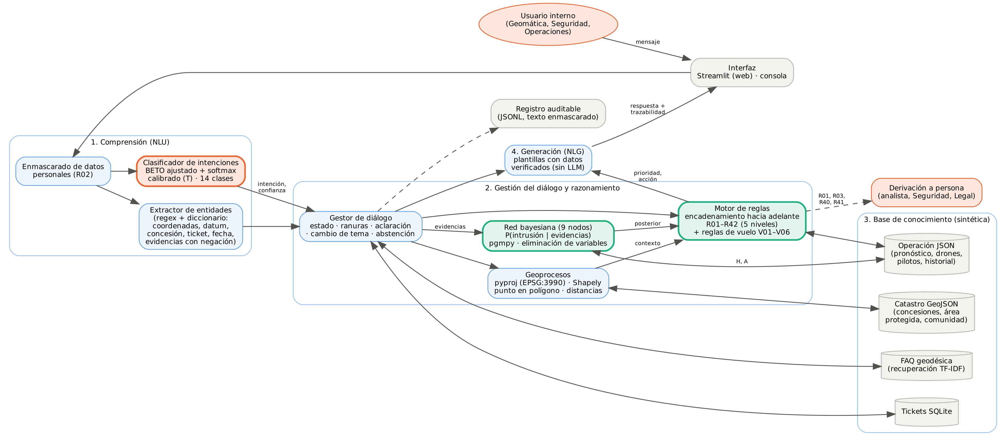
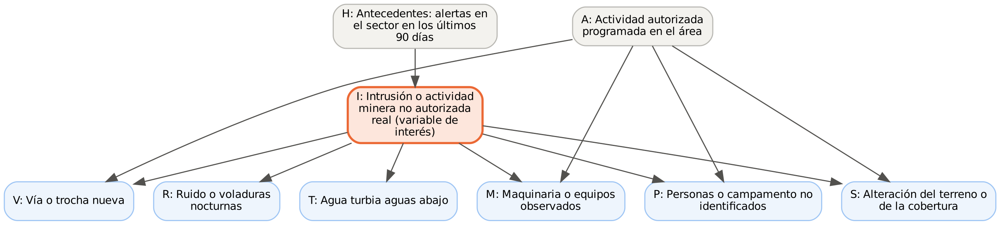
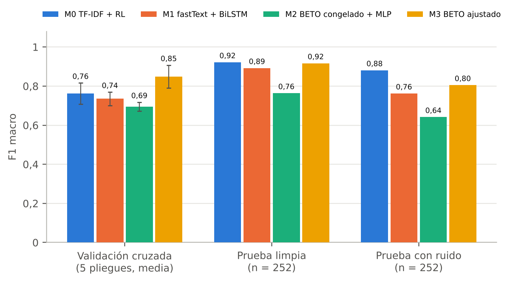
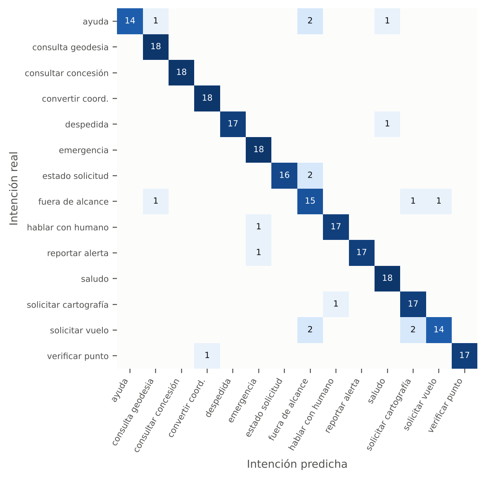
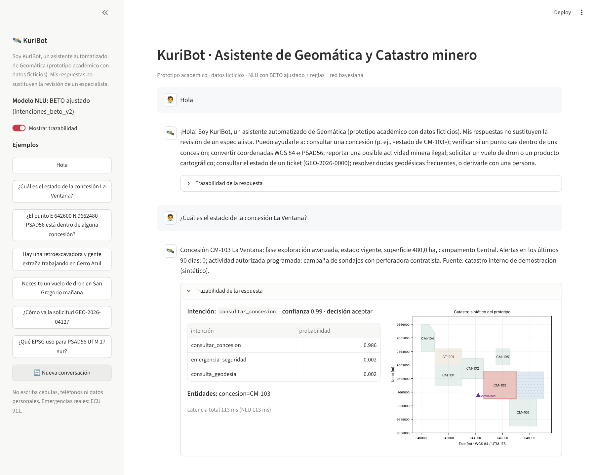
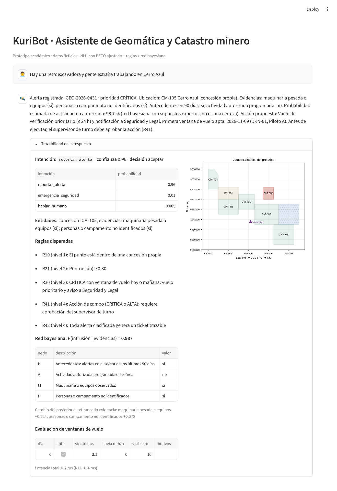
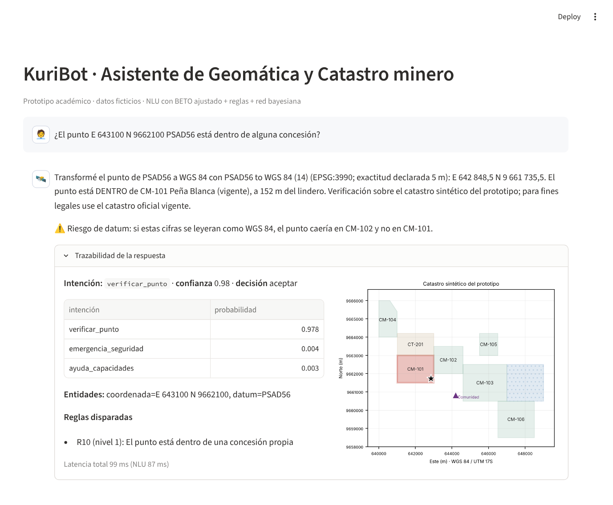
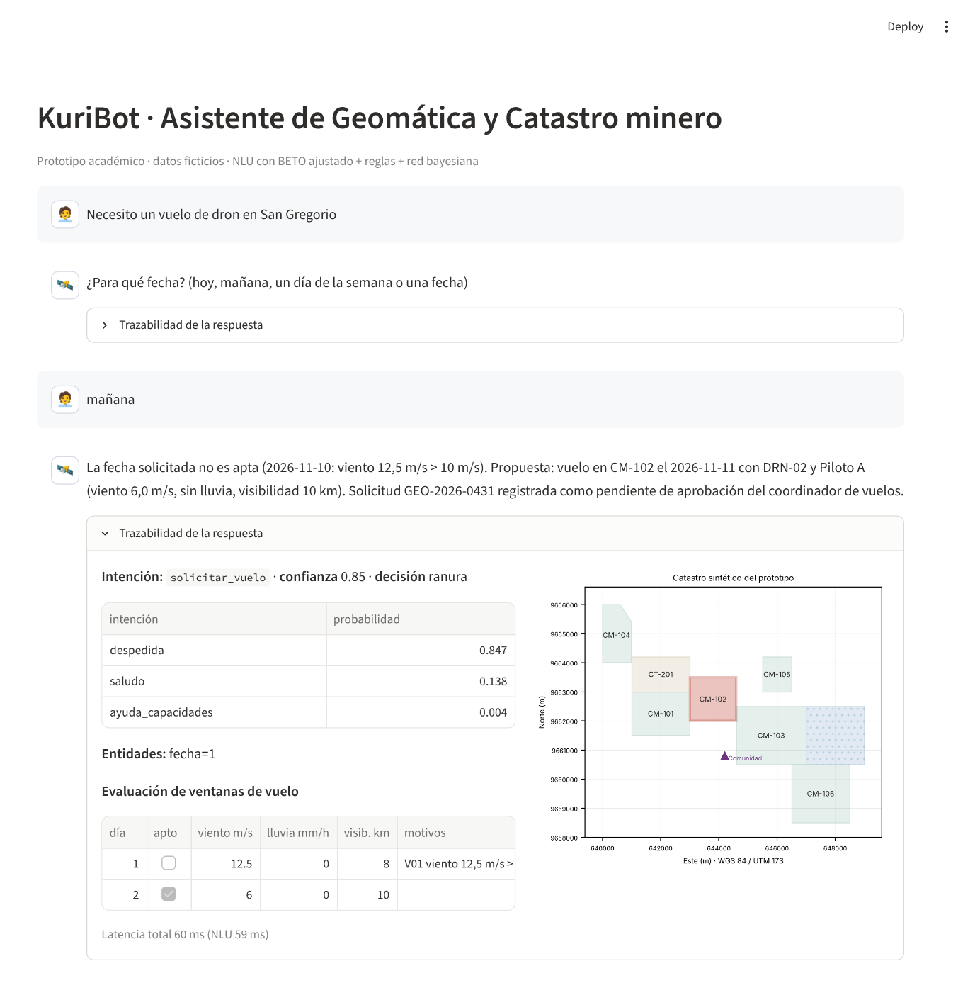
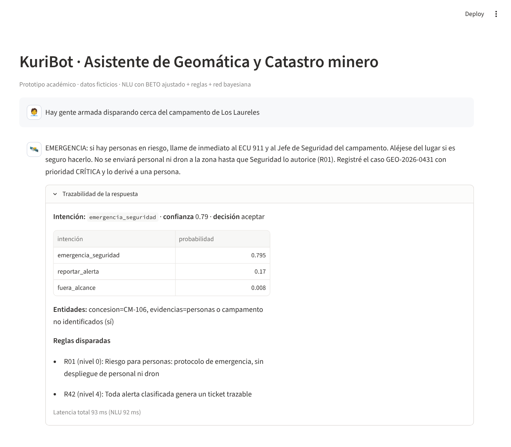
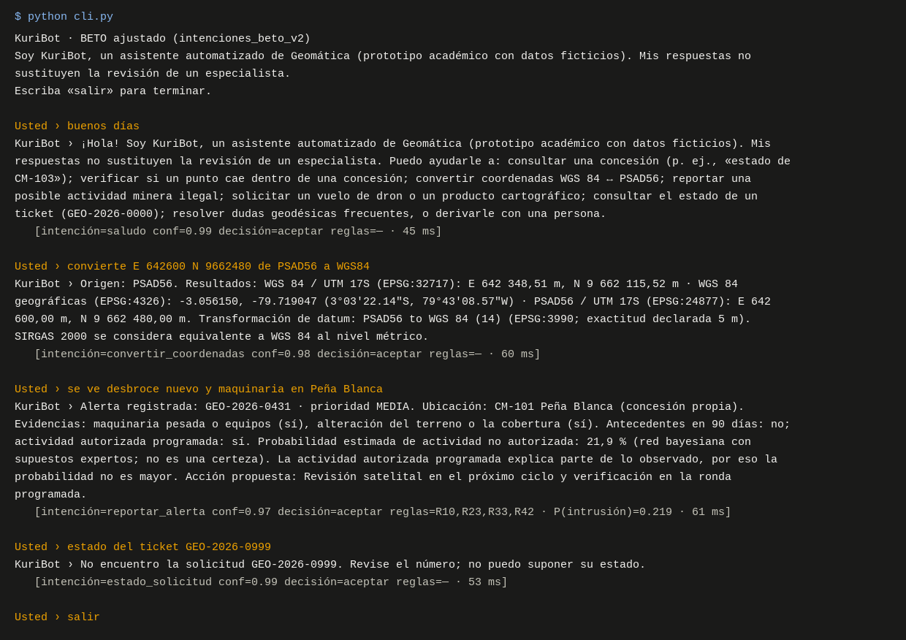

```{=openxml}
<w:p><w:pPr><w:pBdr><w:bottom w:val="single" w:sz="12" w:space="1" w:color="6B0F2B"/></w:pBdr><w:spacing w:after="120"/><w:ind w:firstLine="0"/></w:pPr><w:r><w:rPr><w:noProof/></w:rPr><w:drawing><wp:anchor distT="0" distB="0" distL="114300" distR="114300" simplePos="0" relativeHeight="251659264" behindDoc="0" locked="0" layoutInCell="1" allowOverlap="1"><wp:simplePos x="0" y="0"/><wp:positionH relativeFrom="margin"><wp:align>center</wp:align></wp:positionH><wp:positionV relativeFrom="paragraph"><wp:posOffset>0</wp:posOffset></wp:positionV><wp:extent cx="2867025" cy="1167765"/><wp:effectExtent l="0" t="0" r="9525" b="0"/><wp:wrapSquare wrapText="bothSides"/><wp:docPr id="1909191352" name="Imagen 1"/><wp:cNvGraphicFramePr><a:graphicFrameLocks xmlns:a="http://schemas.openxmlformats.org/drawingml/2006/main" noChangeAspect="1"/></wp:cNvGraphicFramePr><a:graphic xmlns:a="http://schemas.openxmlformats.org/drawingml/2006/main"><a:graphicData uri="http://schemas.openxmlformats.org/drawingml/2006/picture"><pic:pic xmlns:pic="http://schemas.openxmlformats.org/drawingml/2006/picture"><pic:nvPicPr><pic:cNvPr id="0" name="Picture 1"/><pic:cNvPicPr><a:picLocks noChangeAspect="1" noChangeArrowheads="1"/></pic:cNvPicPr></pic:nvPicPr><pic:blipFill><a:blip r:embed="rIdLOGOUEES"><a:extLst><a:ext uri="{28A0092B-C50C-407E-A947-70E740481C1C}"><a14:useLocalDpi xmlns:a14="http://schemas.microsoft.com/office/drawing/2010/main" val="0"/></a:ext></a:extLst></a:blip><a:srcRect/><a:stretch><a:fillRect/></a:stretch></pic:blipFill><pic:spPr bwMode="auto"><a:xfrm><a:off x="0" y="0"/><a:ext cx="2867025" cy="1167765"/></a:xfrm><a:prstGeom prst="rect"><a:avLst/></a:prstGeom><a:noFill/><a:ln><a:noFill/></a:ln></pic:spPr></pic:pic></a:graphicData></a:graphic></wp:anchor></w:drawing></w:r></w:p>
<w:p><w:pPr><w:pBdr><w:bottom w:val="single" w:sz="12" w:space="1" w:color="6B0F2B"/></w:pBdr><w:spacing w:after="120"/><w:ind w:firstLine="0"/></w:pPr></w:p>
<w:p><w:pPr><w:pBdr><w:bottom w:val="single" w:sz="12" w:space="1" w:color="6B0F2B"/></w:pBdr><w:spacing w:after="120"/><w:ind w:firstLine="0"/></w:pPr></w:p>
<w:p><w:pPr><w:pBdr><w:bottom w:val="single" w:sz="12" w:space="1" w:color="6B0F2B"/></w:pBdr><w:spacing w:after="120"/><w:ind w:firstLine="0"/></w:pPr></w:p>
<w:p><w:pPr><w:pBdr><w:bottom w:val="single" w:sz="12" w:space="1" w:color="6B0F2B"/></w:pBdr><w:spacing w:after="120"/><w:ind w:firstLine="0"/></w:pPr></w:p>
<w:p><w:pPr><w:pBdr><w:bottom w:val="single" w:sz="12" w:space="1" w:color="6B0F2B"/></w:pBdr><w:spacing w:after="120"/><w:ind w:firstLine="0"/><w:jc w:val="center"/></w:pPr><w:r><w:rPr><w:b/><w:bCs/><w:sz w:val="28"/><w:szCs w:val="28"/></w:rPr><w:t>Maestría en Inteligencia de Negocios y Ciencia de Datos</w:t></w:r></w:p>
<w:p><w:pPr><w:pBdr><w:bottom w:val="single" w:sz="12" w:space="1" w:color="6B0F2B"/></w:pBdr><w:spacing w:after="120"/><w:ind w:firstLine="0"/><w:jc w:val="center"/></w:pPr><w:r><w:rPr><w:b/><w:bCs/><w:sz w:val="28"/><w:szCs w:val="28"/></w:rPr><w:t>Asignatura: Inteligencia Artificial</w:t></w:r></w:p>
<w:p><w:pPr><w:pBdr><w:bottom w:val="single" w:sz="12" w:space="1" w:color="6B0F2B"/></w:pBdr><w:spacing w:after="120"/><w:ind w:firstLine="0"/></w:pPr></w:p>
<w:p><w:pPr><w:spacing w:before="120"/><w:ind w:firstLine="0"/><w:jc w:val="center"/></w:pPr><w:r><w:rPr><w:b/><w:bCs/><w:sz w:val="44"/><w:szCs w:val="44"/></w:rPr><w:t>Proyecto Integral de Inteligencia Artificial</w:t></w:r></w:p>
<w:p><w:pPr><w:spacing w:before="200"/><w:ind w:left="340" w:right="340" w:firstLine="0"/><w:jc w:val="center"/></w:pPr><w:r><w:t>KuriBot: ChatBot inteligente con deep learning para la mesa de servicios de Geomática de una operación minera</w:t></w:r></w:p>
<w:p><w:pPr><w:pBdr><w:bottom w:val="single" w:sz="4" w:space="1" w:color="6B0F2B"/></w:pBdr><w:spacing w:after="120"/><w:ind w:firstLine="0"/></w:pPr></w:p>
<w:p><w:pPr><w:ind w:left="340" w:right="340" w:firstLine="0"/><w:jc w:val="center"/></w:pPr><w:r><w:t>Clasificación de intenciones con BETO ajustado, red bayesiana de credibilidad de alertas</w:t></w:r></w:p>
<w:p><w:pPr><w:ind w:left="340" w:right="340" w:firstLine="0"/><w:jc w:val="center"/></w:pPr><w:r><w:t>y motor de reglas, sobre un caso sintético del sur del Ecuador</w:t></w:r></w:p>
<w:p><w:pPr><w:ind w:left="340" w:firstLine="0"/><w:jc w:val="center"/></w:pPr></w:p>
<w:p><w:pPr><w:ind w:firstLine="0"/><w:jc w:val="center"/></w:pPr><w:r><w:rPr><w:rFonts w:ascii="Arial" w:eastAsia="Arial" w:hAnsi="Arial" w:cs="Arial"/><w:b/><w:bCs/><w:sz w:val="20"/><w:szCs w:val="20"/></w:rPr><w:t>Actividad grupal · Semana 4: Proyecto integral de inteligencia artificial aplicada a los negocios</w:t></w:r></w:p>
<w:p><w:pPr><w:ind w:left="340" w:firstLine="0"/><w:jc w:val="center"/></w:pPr></w:p>
<w:p><w:pPr><w:ind w:left="340" w:firstLine="0"/><w:jc w:val="center"/></w:pPr></w:p>
<w:tbl><w:tblPr><w:tblW w:w="7600" w:type="dxa"/><w:jc w:val="center"/><w:tblBorders><w:top w:val="none" w:sz="0" w:space="0" w:color="FFFFFF"/><w:left w:val="none" w:sz="0" w:space="0" w:color="FFFFFF"/><w:bottom w:val="none" w:sz="0" w:space="0" w:color="FFFFFF"/><w:right w:val="none" w:sz="0" w:space="0" w:color="FFFFFF"/><w:insideH w:val="none" w:sz="0" w:space="0" w:color="FFFFFF"/><w:insideV w:val="none" w:sz="0" w:space="0" w:color="FFFFFF"/></w:tblBorders><w:tblLayout w:type="fixed"/><w:tblCellMar><w:left w:w="10" w:type="dxa"/><w:right w:w="10" w:type="dxa"/></w:tblCellMar><w:tblLook w:val="04A0" w:firstRow="1" w:lastRow="0" w:firstColumn="1" w:lastColumn="0" w:noHBand="0" w:noVBand="1"/></w:tblPr><w:tblGrid><w:gridCol w:w="2268"/><w:gridCol w:w="5332"/></w:tblGrid><w:tr><w:trPr><w:jc w:val="center"/></w:trPr><w:tc><w:tcPr><w:tcW w:w="2268" w:type="dxa"/></w:tcPr><w:p><w:pPr><w:spacing w:after="60"/><w:ind w:firstLine="0"/><w:jc w:val="right"/></w:pPr><w:r><w:rPr><w:b/><w:bCs/></w:rPr><w:t>Integrantes:</w:t></w:r></w:p></w:tc><w:tc><w:tcPr><w:tcW w:w="5332" w:type="dxa"/></w:tcPr><w:p><w:pPr><w:spacing w:after="20"/><w:ind w:left="170" w:firstLine="0"/><w:jc w:val="left"/></w:pPr><w:r><w:t>Gabriel Ayala Sánchez</w:t></w:r></w:p><w:p><w:pPr><w:spacing w:after="20"/><w:ind w:left="170" w:firstLine="0"/><w:jc w:val="left"/></w:pPr><w:r><w:t>Daniel Castro M.</w:t></w:r></w:p><w:p><w:pPr><w:spacing w:after="20"/><w:ind w:left="170" w:firstLine="0"/><w:jc w:val="left"/></w:pPr><w:r><w:t>Ricardo Ruiz L.</w:t></w:r></w:p><w:p><w:pPr><w:spacing w:after="20"/><w:ind w:left="170" w:firstLine="0"/><w:jc w:val="left"/></w:pPr></w:p></w:tc></w:tr><w:tr><w:trPr><w:jc w:val="center"/></w:trPr><w:tc><w:tcPr><w:tcW w:w="2268" w:type="dxa"/></w:tcPr><w:p><w:pPr><w:spacing w:after="60"/><w:ind w:firstLine="0"/><w:jc w:val="right"/></w:pPr><w:r><w:rPr><w:b/><w:bCs/></w:rPr><w:t>Docente:</w:t></w:r></w:p></w:tc><w:tc><w:tcPr><w:tcW w:w="5332" w:type="dxa"/></w:tcPr><w:p><w:pPr><w:spacing w:after="20"/><w:ind w:left="170" w:firstLine="0"/><w:jc w:val="left"/></w:pPr><w:r><w:t>Jorge Luis Zambrano Martínez, Ph.D.</w:t></w:r></w:p></w:tc></w:tr></w:tbl>
<w:p><w:pPr><w:ind w:left="340" w:firstLine="0"/></w:pPr></w:p>
<w:p><w:pPr><w:ind w:left="340" w:firstLine="0"/></w:pPr></w:p>
<w:p><w:pPr><w:ind w:firstLine="0"/><w:jc w:val="center"/></w:pPr><w:r><w:rPr><w:b/><w:bCs/></w:rPr><w:t xml:space="preserve">Fecha: </w:t></w:r><w:r><w:t>13 de noviembre de 2026</w:t></w:r></w:p>
<w:p><w:pPr><w:ind w:firstLine="0"/><w:jc w:val="center"/></w:pPr></w:p>
<w:p><w:pPr><w:ind w:firstLine="0"/><w:jc w:val="center"/></w:pPr></w:p>
<w:p><w:pPr><w:ind w:firstLine="0"/><w:jc w:val="center"/></w:pPr><w:r><w:t>Guayaquil, Ecuador</w:t></w:r></w:p>
<w:p><w:pPr><w:ind w:left="340" w:firstLine="0"/></w:pPr></w:p>
<w:p><w:pPr><w:ind w:left="340" w:firstLine="0"/></w:pPr></w:p>
<w:p><w:pPr><w:ind w:left="340" w:firstLine="0"/></w:pPr></w:p>
<w:p><w:pPr><w:spacing w:after="40"/><w:ind w:firstLine="0"/></w:pPr><w:r><w:rPr><w:i/><w:iCs/><w:sz w:val="14"/><w:szCs w:val="14"/></w:rPr><w:t>Datos: sintéticos, elaborados por el equipo para la empresa ficticia Minera del Austro S.A.; los códigos EPSG y la transformación PSAD56–WGS 84 provienen de la base geodésica EPSG.</w:t></w:r></w:p>
<w:p><w:pPr><w:ind w:firstLine="0"/></w:pPr><w:r><w:rPr><w:i/><w:iCs/><w:sz w:val="14"/><w:szCs w:val="14"/></w:rPr><w:t>Código completo en el anexo D y en https://github.com/gaboas2703/kuribot-chatbot-geomatica, con un cuaderno ejecutable para Google Colab.</w:t></w:r></w:p>
<w:p><w:pPr><w:pBdr><w:bottom w:val="single" w:sz="12" w:space="1" w:color="6B0F2B"/></w:pBdr><w:spacing w:after="120"/><w:ind w:firstLine="0"/></w:pPr></w:p>
<w:p><w:pPr><w:sectPr><w:pgSz w:w="11906" w:h="16838"/><w:pgMar w:top="1417" w:right="1417" w:bottom="1417" w:left="1417" w:header="708" w:footer="708" w:gutter="0"/><w:cols w:space="720"/><w:docGrid w:linePitch="360"/></w:sectPr></w:pPr></w:p>
```

# Resumen

Este proyecto diseña, implementa y evalúa KuriBot, un ChatBot híbrido para la mesa de servicios de Geomática de una empresa minera ficticia del sur del Ecuador. El asistente reconoce 14 intenciones, entre ellas fichas de concesiones, verificación de puntos en el catastro, conversión de coordenadas PSAD56–WGS 84, reportes de posible minería ilegal, solicitudes de vuelo de dron y de cartografía, seguimiento de tickets, dudas geodésicas, derivación a personas y emergencias. Combina cuatro componentes: un clasificador de intenciones basado en BETO ajustado, un extractor de entidades por reglas, una red bayesiana de nueve nodos que estima la credibilidad de las alertas y un motor de reglas con encadenamiento hacia adelante que asigna prioridades, propone acciones y exige supervisión humana. Se compararon cuatro clasificadores sobre un corpus sintético de 744 expresiones, con validación cruzada agrupada por plantilla y dos conjuntos de prueba de 252 frases, uno limpio y otro con errores de tecleo. BETO ajustado obtuvo el mejor F1 macro en validación cruzada (0,848 frente a 0,762 de la línea base TF-IDF) y, tras una segunda iteración con aumento de datos, alcanzó 0,929 en la prueba limpia y 0,874 con ruido. La suite de 34 escenarios de aceptación pasó de 32 a 34 aprobados entre iteraciones, y ocho escenarios nuevos de confirmación aprobaron siete. El análisis ético y regulatorio se apoya en la Ley Orgánica de Protección de Datos Personales, la norma de la Superintendencia de Protección de Datos sobre sistemas de IA, el Reglamento europeo de IA, el marco del NIST y la recomendación de la UNESCO. Los resultados muestran factibilidad técnica; el valor operativo deberá medirse en un piloto controlado.

**Palabras clave:** ChatBot, clasificación de intenciones, BETO, red bayesiana, sistema basado en reglas, geomática, minería, IA responsable.


```{=openxml}
<w:p><w:r><w:t>§TOC§</w:t></w:r></w:p>
```


# Introducción

En una operación minera, el área de Geomática funciona como una mesa de servicios silenciosa. Operaciones pregunta si un frente de trabajo sigue dentro del lindero, Seguridad reporta maquinaria desconocida cerca de una quebrada, Legal necesita el estado de una concesión antes de una inspección y Medio Ambiente pide un mapa para el informe del mes. Buena parte de esas consultas se repite y llega por canales informales; otra parte, menos frecuente, es delicada: una coordenada expresada en el datum equivocado puede ubicar un pozo a más de cuatrocientos metros de su posición real, y una alerta de minería ilegal mal priorizada puede exponer al personal de campo o dejar sin verificar una intrusión.

Este proyecto aborda ese problema con KuriBot (*kuri* significa «oro» en kichwa), un asistente conversacional para la mesa de servicios de Geomática de una empresa minera ficticia del sur del Ecuador. El caso se inspira en la práctica profesional de uno de los integrantes en geomática y catastro minero, pero todos los datos son sintéticos. KuriBot integra los contenidos del módulo: un clasificador de intenciones basado en una red neuronal *transformer* preentrenada en español y ajustada al dominio, un motor de reglas que hereda la lógica del sistema experto de priorización de alertas construido en la semana 2, una red bayesiana que estima la credibilidad de una alerta bajo incertidumbre (semana 3) y los criterios de diseño, evaluación y riesgo de los chatbots empresariales de la semana 4 (Zambrano Martínez, 2026).

La pregunta que guía el trabajo es práctica: ¿puede una arquitectura híbrida, que combina comprensión neuronal del lenguaje con razonamiento simbólico y probabilístico, resolver de forma confiable y trazable las consultas recurrentes de Geomática y priorizar alertas de campo sin delegar en la máquina las decisiones que corresponden a personas? El objetivo general es diseñar, implementar y evaluar un ChatBot funcional que combine técnicas de IA apropiadas al contexto minero ecuatoriano. Los objetivos específicos son:

1. Formalizar el caso de negocio y sus métricas de éxito, y justificar por qué exige IA y no solo analítica tradicional.
2. Comparar cuatro clasificadores de intenciones, uno de *machine learning* clásico y tres redes neuronales, sin fuga de información.
3. Implementar un motor de reglas y una red bayesiana que respalden y expliquen las decisiones del diálogo.
4. Construir el prototipo, documentar al menos veinte interacciones de prueba y evaluar sus implicaciones éticas y regulatorias.

El documento presenta primero el caso de negocio y el estado del arte; luego la metodología, la arquitectura y el modelado; después los resultados y su contraste con las métricas de éxito, y cierra con el análisis ético, las limitaciones y las conclusiones. Los anexos contienen el manual de usuario, la ficha del modelo, la evidencia de pruebas y el código completo.

# Caso de negocio

## Diagnóstico

Minera del Austro S.A. (nombre ficticio) es una empresa de mediana minería aurífera con seis concesiones propias en tres campamentos, colindante con la concesión de un tercero, un bosque protector y una comunidad. Su área de Geomática, con dos o tres analistas, atiende a cinco áreas internas. Para dimensionar el problema se plantea una línea base **hipotética**, que deberá medirse en un piloto: 240 solicitudes al mes, de las cuales cerca del 55 % son repetitivas (fichas de concesiones, conversiones de coordenadas, estado de pedidos y dudas geodésicas) y toman unos diez minutos cada una, y unas quince alertas mensuales de posible actividad minera no autorizada.

El diagnóstico identifica cinco fricciones. La **dependencia de pocas personas**: cuando el analista está en campo, las consultas simples esperan. La **falta de trazabilidad**: las solicitudes llegan por mensajería y llamadas, sin número de caso. El **riesgo geodésico**: en la zona coexisten coordenadas en PSAD56 y en WGS 84, y la transformación oficial de la base EPSG desplaza un punto unos 443 m en el área del proyecto, suficiente para ubicarlo en la concesión equivocada. La **priorización intuitiva de alertas**: dos reportes con la misma redacción pueden merecer respuestas distintas según los antecedentes del sector o los trabajos autorizados en el área. Y la **seguridad del personal**: una alerta con personas armadas no debe tratarse como una solicitud de vuelo más.

## Actores y alcance

Los usuarios son colaboradores de Operaciones, Seguridad patrimonial, Legal y Catastro, Medio Ambiente y Relaciones Comunitarias; intervienen además el analista de Geomática, que recibe las derivaciones, el coordinador de vuelos, el supervisor de turno, que aprueba toda acción de campo, y el responsable de protección de datos. El prototipo reconoce 14 intenciones: saludo, despedida, ayuda, consultar una concesión, verificar un punto, convertir coordenadas, reportar una alerta, solicitar un vuelo de dron, solicitar cartografía, consultar una solicitud, resolver una duda geodésica, hablar con una persona, reportar una emergencia y mensajes fuera de alcance. Quedan excluidos de forma deliberada emitir certificados, modificar el catastro, autorizar vuelos o intervenciones (solo propone y registra), identificar personas, conectarse con la Agencia de Regulación y Control (ARCOM) o con servicios meteorológicos reales y dar asesoría legal.

## Métricas de éxito

Las metas de la Tabla 1 se fijaron antes de evaluar los modelos y combinan métricas técnicas, de sistema y de negocio (Zambrano Martínez, 2026). Las de negocio quedan como objetivos de un piloto, porque un prototipo con datos sintéticos no puede demostrarlas.


::: {custom-style="Leyenda de tabla o figura"}
**Tabla 1.**
:::

::: {custom-style="Leyenda de tabla o figura"}
*Métricas de éxito definidas antes de la evaluación*
:::


| Dimensión | Indicador | Meta |
|:--|:--|:--|
| NLP | F1 macro en prueba limpia (frases redactadas aparte) | ≥ 0,90 |
| NLP | F1 macro en prueba con ruido ortográfico | ≥ 0,85 |
| NLP | Exhaustividad de la clase «fuera de alcance» | ≥ 0,80 |
| NLP | Error de calibración esperado (ECE) tras escalado de temperatura | ≤ 0,05 |
| NLP | Latencia del clasificador, percentil 95, en CPU | ≤ 300 ms |
| Sistema | Escenarios de aceptación aprobados | ≥ 90 % |
| Sistema | Emergencias con riesgo para personas derivadas a una persona | 100 % |
| Sistema | Alertas en concesiones de terceros calificadas como intrusión | 0 |
| Sistema | Acciones de campo propuestas sin aprobación humana | 0 |
| Sistema | Respuestas con datos inventados (tickets o concesiones inexistentes) | 0 |
| Sistema | Latencia de extremo a extremo, percentil 95 | ≤ 1 500 ms |
| Negocio (piloto) | Contención de consultas repetitivas; tiempo del reporte a la decisión; satisfacción (CSAT) | ≥ 50 %; < 5 min; ≥ 4/5 |

## Inteligencia artificial, *machine learning* y analítica tradicional

La IA busca comportamiento inteligente en máquinas: percibir, representar conocimiento, razonar, aprender y actuar (Russell y Norvig, 2021). El *machine learning* es el subconjunto que induce ese comportamiento a partir de datos: un programa aprende de la experiencia *E* respecto de una tarea *T* y una medida *P* si su rendimiento en *T*, medido por *P*, mejora con *E* (Mitchell, 1997). El *deep learning* es la familia del *machine learning* basada en redes con múltiples capas de representación (Goodfellow et al., 2016). La pregunta útil no es «¿IA o ML?», sino qué parte del problema conviene aprender y qué parte conviene programar (Zambrano Martínez, 2026).

En KuriBot solo un componente aprende de datos: el clasificador de intenciones, cuya tarea *T* es asignar a cada mensaje una de 14 intenciones, con la experiencia *E* de 744 expresiones etiquetadas y la medida *P* del F1 macro en frases nunca vistas. El resto es IA que no es *machine learning*: reglas explícitas, una red bayesiana con parámetros elicitados por expertos, una búsqueda de ventanas de vuelo y geoprocesos deterministas (Tabla 2). Una consulta SQL puede devolver el estado de la concesión CM-105, pero no entender que «¿cerro azul está activa?» pide exactamente eso, ni advertir que a unas coordenadas les falta el datum. Tampoco conviene resolver todo con *machine learning*: las alertas verificadas son pocas y no existe un histórico etiquetado para entrenar un modelo de priorización, y la seguridad del personal y los derechos de terceros no pueden quedar a merced de una probabilidad.


::: {custom-style="Leyenda de tabla o figura"}
**Tabla 2.**
:::

::: {custom-style="Leyenda de tabla o figura"}
*Diferenciación de enfoques y su papel en KuriBot*
:::


| Enfoque | Qué aporta | Qué no puede hacer por sí solo | Uso en KuriBot |
|:--|:--|:--|:--|
| Analítica tradicional (SQL, SIG) | Consultas exactas sobre datos estructurados | Interpretar texto libre o razonar con evidencia incierta | Consultas al catastro una vez entendida la intención |
| *Machine learning* clásico | Patrones léxicos con pocos datos | Generalizar a paráfrasis y errores ortográficos | Línea base TF-IDF + regresión logística (M0) |
| *Deep learning* | Representaciones contextuales del lenguaje | Garantizar políticas, conocer hechos, explicar decisiones | BETO ajustado para clasificar intenciones (M3) |
| IA simbólica (reglas) | Decisiones auditables y restricciones de seguridad | Cubrir la variabilidad del lenguaje | Motor de reglas R01–R42 y reglas de vuelo V01–V06 |
| IA probabilística | Combinar evidencias inciertas con conocimiento experto | Obtener probabilidades válidas sin datos ni elicitación | Red bayesiana de credibilidad de alertas |

## Escenario económico

Con la línea base hipotética, si el asistente resolviera sin intervención la mitad de las 132 consultas repetitivas mensuales, liberaría unas 11 horas de analista al mes (132 × 0,5 × 10 min); a un costo cargado supuesto de USD 10 por hora, el ahorro directo sería de unos USD 1 300 al año, modesto frente al costo de integrar y mantener el sistema. El argumento económico principal es otro: reducir los errores de datum en entregas con efectos legales y acortar el tiempo entre un reporte de campo y la decisión de verificarlo. Ninguno de esos beneficios puede cuantificarse con datos sintéticos, de modo que la decisión de inversión debe tomarse después de un piloto.

# Estado del arte

## ChatBots en la empresa y en la industria

Adamopoulou y Moussiades (2020) clasifican los chatbots por dominio, servicio, objetivo y método de respuesta (reglas, recuperación o generación) y muestran que su calidad depende tanto de la integración con fuentes de conocimiento como del modelo de lenguaje. Caldarini et al. (2022) documentan el paso hacia arquitecturas de *deep learning*, junto con la falta de criterios de evaluación comparables y el predominio de recursos en inglés, límites que este proyecto enfrenta con métricas explícitas y un corpus propio en español. Følstad et al. (2021) proponen una agenda centrada en el usuario, el impacto, la ética y la confianza, y Adam et al. (2021) advierten que las señales antropomórficas aumentan la complacencia del usuario, razón por la que KuriBot se presenta siempre como asistente automatizado. En la industria, Colabianchi et al. (2023) proponen una arquitectura de cinco módulos para agentes conversacionales industriales y Wellsandt et al. (2022) describen asistentes de mantenimiento con inteligencia híbrida aumentada, que acercan la información al operador sin retirarle la decisión. No se identificaron estudios sobre asistentes conversacionales para catastro minero o geomática en español; esa es la brecha aplicada que atiende este trabajo.

## Clasificación de intenciones con modelos preentrenados

Larson et al. (2019) mostraron, con 150 intenciones, que los clasificadores aciertan dentro del dominio pero fallan con consultas fuera de alcance, y que entrenar con ejemplos de esa clase mejora su detección; por eso KuriBot tiene una clase «fuera de alcance» y un umbral de abstención. Casanueva et al. (2020) encontraron que los codificadores preentrenados detectan intenciones con pocas decenas de ejemplos por clase, el escenario de este proyecto. La arquitectura *transformer* (Vaswani et al., 2017) y el preentrenamiento bidireccional de BERT (Devlin et al., 2019) son la base de BETO, el BERT entrenado con un corpus grande en español (Cañete et al., 2020). Como alternativa liviana se evaluaron vectores fastText con información de subpalabras (Bojanowski et al., 2017) y una red LSTM (Hochreiter y Schmidhuber, 1997). Guo et al. (2017) demostraron que las redes modernas son sobreconfiadas y que un escalado de temperatura corrige gran parte del problema, algo indispensable cuando la confianza decide si el bot responde, pregunta o se abstiene.

## Razonamiento híbrido y minería ilegal

Una red bayesiana representa una distribución conjunta mediante un grafo acíclico dirigido y tablas de probabilidad condicional, y permite inferencia exacta bajo incertidumbre (Koller y Friedman, 2009; Pearl, 1988). En minería, Mishra et al. (2021) combinaron juicio experto y datos de sitio en una red bayesiana de riesgo geotécnico, precedente directo de parámetros elicitados que se actualizan con datos. Garcez y Lamb (2023) describen la integración de aprendizaje y razonamiento como la tercera ola de la IA; KuriBot aplica esa idea de forma modesta: la red neuronal interpreta el lenguaje y los componentes simbólicos y probabilísticos deciden. En el Ecuador, Mestanza-Ramón et al. (2022) señalan la débil coordinación entre Estado, comunidades y mineros y la insuficiente fiscalización de la minería aurífera, y Chuizaca-Espinoza et al. (2026) documentaron con Sentinel-2 y *random forest* la expansión de la minería ilegal en el río Nangaritza. Ese tipo de alerta satelital es una de las evidencias que recibe la red bayesiana, con una condición: la detección remota orienta la verificación, no la sustituye.

# Metodología

## Diseño, corpus y particiones

El trabajo sigue un ciclo de ciencia del diseño adaptado de CRISP-DM y alineado con las cuatro fases de la actividad: negocio y arquitectura; datos y modelado; implementación y pruebas en dos iteraciones; evaluación, ética y defensa. Es un estudio de ingeniería con datos sintéticos, no un experimento con usuarios.

El equipo redactó 406 plantillas para las 14 intenciones, en español de uso laboral ecuatoriano y con registros formales e informales. Las plantillas con marcadores (concesión, coordenadas, ticket, producto, fecha) se instanciaron tres veces con valores del catastro sintético, lo que produjo 744 expresiones de entrenamiento y validación. Aparte, y con otra formulación, se redactaron 18 frases de prueba por intención (252). Para medir robustez, cada frase de prueba se perturbó con una semilla fija (minúsculas, sin tildes, abreviaturas de chat como «q» o «porfa» y un error de tecleo con probabilidad 0,7), lo que dio la **prueba con ruido** de 252 frases. Ninguna frase de prueba coincide con una de entrenamiento, y todas las variantes de una plantilla comparten un identificador de grupo para que la validación cruzada nunca las separe (StratifiedGroupKFold). El desbalance entre clases (de 24 a 90 ejemplos) se compensa con pesos de clase.

Antes de clasificar, cada mensaje pasa por dos pasos deterministas comunes a todos los modelos: el enmascarado de datos personales (cédulas con dígito verificador válido, teléfonos y correos) y el de entidades, que sustituye coordenadas, tickets y códigos por su tipo. Así el clasificador aprende la intención por el contexto y el extractor se encarga de los valores.

## Modelos comparados

- **M0, TF-IDF + regresión logística:** unigramas y bigramas de palabras más n-gramas de caracteres de 2 a 5, con pesos balanceados; es la línea base de *machine learning* clásico.
- **M1, fastText + BiLSTM:** vectores de 300 dimensiones del modelo es_core_news_lg de spaCy (Honnibal et al., 2020), una LSTM bidireccional de 128 unidades, agregación por atención y por máximo, y un perceptrón multicapa.
- **M2, BETO congelado + MLP:** media estandarizada de la última capa de BETO y un perceptrón de 256 unidades ocultas.
- **M3, BETO ajustado:** el *transformer* completo se ajusta de extremo a extremo con una capa lineal de salida.

Los pesos de BETO se obtuvieron del pipeline oficial es_dep_news_trf 3.8.0 de spaCy, publicado en GitHub, porque el entorno de desarrollo no tenía acceso a otros repositorios de modelos. Ese pipeline contiene BETO ajustado por spaCy para análisis morfosintáctico, de modo que no es idéntico al original; la conversión se verificó contra la implementación de origen, con una diferencia máxima de 4,1 × 10⁻⁶.

## Protocolo de evaluación

Los modelos se comparan con validación cruzada de cinco pliegues estratificada por intención y agrupada por plantilla, con una parte de cada pliegue reservada para la parada temprana. Después, cada modelo se entrena con el 85 % del corpus y se valida con el 15 % restante, que también fija la temperatura de calibración y el umbral de confianza; ninguna decisión se toma con el conjunto de prueba. Se reportan exactitud con intervalo de Wilson, F1 macro con intervalo *bootstrap* de 2 000 remuestreos, métricas por clase, matriz de confusión, error de calibración esperado, latencia y parámetros entrenables, y las diferencias se contrastan con la prueba exacta de McNemar (Dietterich, 1998). Se usaron scikit-learn (Pedregosa et al., 2011), PyTorch (Paszke et al., 2019), Transformers (Wolf et al., 2020) y pgmpy (Ankan y Panda, 2015), con semillas fijas y CPU de dos hilos; las tablas y figuras se generan desde los archivos de resultados, sin transcripción manual.

La evaluación funcional usa una suite de 34 escenarios (43 turnos) con criterios fijados antes de ejecutarla: intención esperada, acción o regla esperada, fragmentos obligatorios en la respuesta y latencia inferior a 1 500 ms. Se ejecuta en dos iteraciones, la primera para revelar fallos y la segunda para verificar los ajustes, y se complementa con 34 pruebas unitarias y con ocho escenarios de confirmación redactados al final y ejecutados una sola vez.

# Arquitectura del sistema

La arquitectura sigue la separación clásica entre comprensión, gestión del diálogo y generación (Adamopoulou y Moussiades, 2020; Zambrano Martínez, 2026), con dos decisiones propias: la red neuronal solo decide la **intención**, nunca los hechos ni las acciones, y toda respuesta se construye con plantillas a partir de datos verificados, sin un modelo generativo que pueda inventar cifras (Figura 1).


::: {custom-style="Leyenda de tabla o figura"}
**Figura 1.**
:::

::: {custom-style="Leyenda de tabla o figura"}
*Arquitectura de componentes de KuriBot*
:::

::: {custom-style="Figura"}
{width=100%}
:::


::: {custom-style="Nota de tabla"}
*Nota.* Las flechas discontinuas indican registro y derivación a personas. Elaboración propia.
:::


Cada mensaje sigue siete pasos: (1) se enmascaran los datos personales; (2) una red de seguridad busca señales de emergencia; (3) el extractor obtiene coordenadas, datum, concesión, ticket, fecha, producto y evidencias, con detección de negaciones; (4) si había una acción pendiente, se intenta completar la ranura que faltaba; (5) si no, el clasificador predice la intención y su confianza calibrada; (6) la política de la intención consulta el catastro, ejecuta geoprocesos e invoca la red bayesiana y el motor de reglas; (7) la respuesta se genera con plantillas y se acompaña de una traza auditable (intención, confianza, reglas, posterior bayesiano y latencia). La base de conocimiento es sintética: un catastro en GeoJSON (seis concesiones propias, una de un tercero, un bosque protector y una comunidad), un archivo de operación (pronóstico de cinco días, drones, pilotos, historial de alertas y actividades autorizadas), una FAQ geodésica de 19 entradas y una base SQLite de tickets.

# Modelado del componente inteligente

## Clasificador de intenciones

Para un mensaje con piezas $x_1,\dots,x_n$, BETO produce estados contextuales $\mathbf{h}_i\in\mathbb{R}^{768}$; la representación del mensaje es su media y la distribución sobre las 14 intenciones se obtiene con una capa lineal y la temperatura $T$:

$$\bar{\mathbf{h}}=\frac{1}{n}\sum_{i=1}^{n}\mathbf{h}_i,\qquad \hat{\mathbf{p}}=\operatorname{softmax}\!\left(\frac{\mathbf{W}\bar{\mathbf{h}}+\mathbf{b}}{T}\right)$$

El ajuste minimiza la entropía cruzada ponderada por clase, con suavizado de etiquetas de 0,05, AdamW (tasa 3 × 10⁻⁵), lotes de 16, hasta 48 piezas por mensaje y parada temprana sobre el F1 macro de validación. $T$ se estima después del entrenamiento minimizando la log-verosimilitud negativa en validación (Guo et al., 2017). La decisión usa la confianza calibrada $p_1$ y la segunda probabilidad $p_2$, pues la probabilidad máxima del softmax es una base sencilla y eficaz para detectar errores y entradas ajenas al entrenamiento (Hendrycks y Gimpel, 2017): si $p_1$ ≥ máx(0,50; $\tau$), el bot **acepta** la intención; si $p_1$ ≥ 0,30 y $p_1+p_2$ ≥ 0,70, **pide aclaración** entre las dos opciones; en otro caso **se abstiene**, explica lo que puede hacer y, al segundo fallo seguido, ofrece una persona. El umbral $\tau$ se elige en validación.

## Red bayesiana de credibilidad de alertas

El nodo de interés $I$ representa una actividad minera no autorizada real (Figura 2). Su causa son los antecedentes del sector ($H$, alertas en los últimos 90 días). La actividad autorizada programada ($A$) es una causa alternativa de varias evidencias: maquinaria ($M$), personas o campamento ($P$), alteración del terreno ($S$) y vía nueva ($V$); el ruido nocturno ($R$) y la turbidez ($T$) dependen solo de $I$. $H$ y $A$ se observan en la base de conocimiento; las evidencias se extraen del mensaje, incluidas las negadas («no hay personas» fija $P=0$), y las no mencionadas se marginalizan. Las tablas de probabilidad condicional de la Tabla 3 son juicios expertos del equipo, no frecuencias estimadas.


::: {custom-style="Leyenda de tabla o figura"}
**Figura 2.**
:::

::: {custom-style="Leyenda de tabla o figura"}
*Grafo de la red bayesiana de credibilidad de alertas*
:::

::: {custom-style="Figura"}
{width=78%}
:::


::: {custom-style="Nota de tabla"}
*Nota.* Elaboración propia, generado desde el código.
:::


::: {custom-style="Leyenda de tabla o figura"}
**Tabla 3.**
:::

::: {custom-style="Leyenda de tabla o figura"}
*Tablas de probabilidad condicional elicitadas, P(X = 1 | padres)*
:::


| Nodo | Padres | I=0, A=0 | I=0, A=1 | I=1, A=0 | I=1, A=1 |
|:--|:--|--:|--:|--:|--:|
| M: maquinaria | I, A | 0,03 | 0,60 | 0,70 | 0,85 |
| P: personas o campamento | I, A | 0,10 | 0,50 | 0,75 | 0,85 |
| S: alteración del terreno | I, A | 0,05 | 0,45 | 0,65 | 0,80 |
| V: vía o trocha nueva | I, A | 0,03 | 0,20 | 0,40 | 0,45 |
| R: ruido o voladuras nocturnas | I | 0,05 | — | 0,40 | — |
| T: agua turbia | I | 0,15 | — | 0,40 | — |

::: {custom-style="Nota de tabla"}
*Nota.* Para el nodo de interés, P(I = 1 | H = 0) = 0,10 y P(I = 1 | H = 1) = 0,30. Las probabilidades a priori P(H = 1) = 0,30 y P(A = 1) = 0,40 solo se usan cuando H o A no se observan en la base de conocimiento.
:::


La inferencia es exacta por eliminación de variables (pgmpy): para una evidencia $\mathbf{e}$, el posterior normaliza la distribución conjunta sobre las variables no observadas $\mathbf{z}$, y se verificó por enumeración completa con diferencias menores que 10⁻⁹.

$$P(I=1\mid\mathbf{e})=\frac{\sum_{\mathbf{z}}P(I=1,\mathbf{e},\mathbf{z})}{\sum_{i\in\{0,1\}}\sum_{\mathbf{z}}P(I=i,\mathbf{e},\mathbf{z})},\qquad P(\mathbf{x})=\prod_{k}P(x_k\mid \mathrm{pa}(x_k))$$

La estructura captura la explicación alternativa (*explaining away*): maquinaria y desbroce en Peña Blanca, sin antecedentes, dan un posterior de 0,219 porque hay un frente de explotación autorizado; la misma evidencia en un área sin actividad programada lo eleva a 0,971. Un análisis de sensibilidad (±0,10 en cada parámetro) mostró que el posterior depende mucho más del prior $P(I=1\mid H=0)$ (rango 0,02–0,39) que de cualquier verosimilitud (rangos menores de 0,08); por eso lo primero que debe calibrarse con verificaciones de campo es la tasa base de intrusiones por sector.

## Motor de reglas y umbrales de decisión

El motor es un sistema de producción con encadenamiento hacia adelante: en cada ciclo arma la agenda con las reglas aplicables, dispara la de menor nivel y mayor prioridad, agrega sus conclusiones a la memoria de trabajo y no la repite (refracción). Las prioridades son excluyentes y una prueba automatizada comprueba que barajar el orden de las reglas no cambia la conclusión (Tabla 4). R12 y R20 impiden tratar como intrusión lo que ocurre en la concesión de un tercero, y R40 obliga a la revisión humana cerca de comunidades o áreas protegidas, criterios de equidad heredados de la semana 2.


::: {custom-style="Leyenda de tabla o figura"}
**Tabla 4.**
:::

::: {custom-style="Leyenda de tabla o figura"}
*Base de reglas del motor de decisiones (resumen)*
:::


| Nivel | Reglas | Condición → conclusión |
|:--|:--|:--|
| 0. Seguridad | R01–R03 | Emergencia con riesgo para personas → CRÍTICA, protocolo, sin despliegue y derivación humana; datos personales → enmascarar; pedido de una persona → derivar |
| 1. Contexto geoespacial | R10–R15 | Concesión propia; franja de 500 m; concesión de tercero; área protegida; comunidad a 1 km o menos; fuera del área |
| 2. Priorización | R20–R25 | Derecho de tercero → REVISIÓN LEGAL; P(I) ≥ 0,80 CRÍTICA; ≥ 0,50 ALTA; ≥ 0,15 MEDIA; resto BAJA; fuera del área → INFORMATIVA |
| 3. Acción | R30–R36 | Vuelo prioritario si hay ventana en 24 h, si no satélite y patrullaje; vuelo en 72 h; revisión satelital; registro; derivación a Legal |
| 4. Salvaguardas | R40–R42 | Zona sensible → revisión humana; CRÍTICA o ALTA → aprobación del supervisor; toda alerta → ticket |
| Vuelos | V01–V06 | Viento > 10 m/s, lluvia, visibilidad < 5 km, sin dron, sin piloto o menos de un día de anticipación → no apto; búsqueda de la primera ventana apta |

::: {custom-style="Nota de tabla"}
*Nota.* Los umbrales de 500 m, 1 km, 10 m/s y 5 km son supuestos de diseño del equipo.
:::


El umbral inferior de acción se deriva de una razón de costos: si verificar con dron cuesta $C$ y no detectar a tiempo una intrusión real cuesta $L$, conviene verificar cuando $P(I\mid\mathbf{e})\,L \ge C$, es decir, cuando $P(I\mid\mathbf{e}) \ge C/L$. Con el supuesto $L/C$ ≈ 6,7, el umbral queda en 0,15, que separa BAJA de MEDIA; 0,50 y 0,80 escalan el plazo de verificación. Con costos asimétricos, la métrica y el umbral son decisiones de negocio (Zambrano Martínez, 2026).

El gestor de diálogo guarda la acción pendiente, sus ranuras, la última concesión mencionada y los fallos seguidos. Si falta un dato (concesión, coordenadas, datum, fecha, producto o evidencias), lo pide y completa la acción cuando llega; si llega otra intención con confianza suficiente, abandona la pendiente; tras dos intentos fallidos ofrece una persona, y «cancelar» anula la acción en cualquier momento.


# Resultados

## Implementación

KuriBot está escrito en Python y organizado en módulos con responsabilidades separadas: entidades, geodesia, base de conocimiento, modelos e inferencia de intenciones, razonamiento y gestor de diálogo (Anexo D). Tiene dos interfaces sobre el mismo motor. La web, construida con Streamlit, muestra la conversación y, bajo cada respuesta, un panel de trazabilidad con la intención, las probabilidades, las entidades, las reglas disparadas, el posterior bayesiano, las ventanas de vuelo y un mapa del catastro; la de consola imprime la misma información en una línea técnica (Anexo A). El modelo de producción ocupa 219 MB en media precisión y corre en CPU sin servicios externos; si faltan sus pesos, la aplicación usa la línea base TF-IDF y lo advierte.

## Desempeño del componente NLP

En la validación cruzada agrupada por plantilla, la prueba más exigente porque cada pliegue evalúa formulaciones nuevas, BETO ajustado (M3) superó con claridad a los demás: F1 macro de 0,848 frente a 0,762 de la línea base (Tabla 5 y Figura 3). En la prueba limpia, en cambio, M3 y la línea base TF-IDF quedaron prácticamente empatados (0,917 y 0,922; McNemar p = 0,86), y con ruido ortográfico la línea base fue mejor (0,881 frente a 0,805; p = 0,005): los n-gramas de caracteres toleran una letra cambiada, mientras que BETO divide una palabra con errata en piezas que nunca vio juntas. La BiLSTM con fastText (cobertura del vocabulario de 96,9 %) perdió 13 puntos con ruido porque trabaja con palabras completas, y BETO congelado fue el peor (0,764), coherente con que sus pesos se ajustaron en spaCy para sintaxis y no para semántica.


::: {custom-style="Leyenda de tabla o figura"}
**Tabla 5.**
:::

::: {custom-style="Leyenda de tabla o figura"}
*Comparación de modelos de intenciones, iteración 1*
:::


| Modelo | F1 macro VC (media ± DE) | F1 prueba limpia [IC 95 %] | F1 prueba con ruido [IC 95 %] | ECE calibrado (limpia) | Parámetros entrenables | Latencia p95 (ms) |
|:--|--:|--:|--:|--:|--:|--:|
| M0 TF-IDF + RL | 0,762 ± 0,054 | 0,922 [0,89–0,95] | 0,881 [0,84–0,92] | 0,037 | 109 886 | 1,3 |
| M1 fastText + BiLSTM | 0,735 ± 0,034 | 0,892 [0,85–0,93] | 0,762 [0,70–0,81] | 0,057 | 683 547 | 2,3 |
| M2 BETO congelado + MLP | 0,695 ± 0,023 | 0,764 [0,70–0,81] | 0,642 [0,58–0,70] | 0,048 | 200 462 | 52,5 |
| M3 BETO ajustado (fine-tuning) | 0,848 ± 0,059 | 0,917 [0,88–0,95] | 0,805 [0,75–0,85] | 0,048 | 109 271 054 | 45,2 |

::: {custom-style="Nota de tabla"}
*Nota.* VC = validación cruzada de cinco pliegues agrupada por plantilla; IC = intervalo *bootstrap* de 2 000 remuestreos; la latencia es por mensaje en CPU de dos hilos.
:::


::: {custom-style="Leyenda de tabla o figura"}
**Figura 3.**
:::

::: {custom-style="Leyenda de tabla o figura"}
*F1 macro de los cuatro modelos en validación cruzada y en los conjuntos de prueba, iteración 1*
:::

::: {custom-style="Figura"}
{width=80%}
:::


::: {custom-style="Nota de tabla"}
*Nota.* Las barras de error muestran una desviación estándar entre pliegues.
:::


La decisión no podía tomarse solo por el F1 en limpio. M3 generalizó mejor a formulaciones nuevas, detectó mucho mejor los mensajes fuera de alcance (exhaustividad de 0,833 frente a 0,611 en la prueba limpia), que es la clase donde un error produce una respuesta impropia (Larson et al., 2019), y su debilidad, los errores de tecleo, tenía un remedio conocido. Por eso se eligió como modelo de producción y se planteó una segunda iteración para mejorar su robustez.

## Iteración 2: ajustes del modelo

Casi todos los errores de M3 con ruido ocurrían en palabras con errata o sin tilde («agenda drrone para San Gregorio» se clasificó como consulta de concesión). Se aplicaron tres ajustes, todos con datos de entrenamiento y validación: (1) una copia perturbada de cada frase de entrenamiento, con una semilla distinta de la de prueba, siguiendo las técnicas de aumento simple para texto (Wei y Zou, 2019); (2) ocho plantillas nuevas de alertas con coordenadas, motivadas por el fallo A17 de la suite de aceptación; y (3) hasta diez épocas con paciencia de tres, porque el F1 de validación seguía subiendo en la sexta.


::: {custom-style="Leyenda de tabla o figura"}
**Tabla 6.**
:::

::: {custom-style="Leyenda de tabla o figura"}
*Efecto de los ajustes de la iteración 2 sobre la línea base y el modelo de producción*
:::


| Versión | Modelo | F1 limpia | F1 ruido | Exactitud limpia | ECE calibrado | Épocas entrenadas | τ |
|:--|:--|--:|--:|--:|--:|--:|--:|
| v1 | M0 TF-IDF + RL | 0,922 | 0,881 | 0,925 | 0,037 | — | 0,20 |
| v1 | M3 BETO ajustado (fine-tuning) | 0,917 | 0,805 | 0,917 | 0,048 | 6 | 0,20 |
| v2 | M0 TF-IDF + RL | 0,906 | 0,861 | 0,909 | 0,036 | — | 0,35 |
| v2 | M3 BETO ajustado (fine-tuning) | 0,929 | 0,874 | 0,929 | 0,042 | 7 | 0,40 |

::: {custom-style="Nota de tabla"}
*Nota.* v1: corpus original y hasta 6 épocas; v2: plantillas nuevas, una copia con ruido por frase y hasta 10 épocas. τ es el umbral elegido en validación; el bot acepta con confianza ≥ máx(0,50; τ).
:::


El aumento benefició al *transformer* y no a la línea base (Tabla 6). M3 pasó de 0,805 a 0,874 con ruido, una mejora significativa (25 aciertos nuevos frente a 9 perdidos; McNemar p = 0,009), y de 0,917 a 0,929 en limpio, mientras M0 bajó levemente en ambos conjuntos. Frente a la mejor línea base de la iteración 1, el modelo final ya no difiere de forma significativa (p = 1,00 en limpio y p = 0,74 con ruido), pero conserva la ventaja en detección fuera de alcance (0,833 y 0,778 de exhaustividad frente a 0,556 y 0,444 de M0). La parada temprana se activó en la séptima época, con el mejor F1 de validación en la cuarta.

## Desempeño por intención y calibración

Las clases más difíciles son «fuera de alcance» (F1 de 0,769), que agrupa temas heterogéneos, y «solicitar vuelo» (0,848), que se confunde con cartografía cuando se pide una ortofoto, que en efecto exige volar (Tabla 7). La matriz de confusión (Figura 4) muestra que los errores se concentran en pares semánticamente cercanos: verificar frente a convertir coordenadas, y cartografía frente a vuelo o concesión.


::: {custom-style="Leyenda de tabla o figura"}
**Tabla 7.**
:::

::: {custom-style="Leyenda de tabla o figura"}
*Precisión, exhaustividad y F1 por intención del modelo de producción (M3, iteración 2)*
:::


| Intención | Precisión | Exhaustividad | F1 (limpia) | F1 (ruido) | Soporte |
|:--|--:|--:|--:|--:|--:|
| ayuda capacidades | 1,000 | 0,778 | 0,875 | 0,824 | 18 |
| consulta geodesia | 0,900 | 1,000 | 0,947 | 0,865 | 18 |
| consultar concesion | 1,000 | 1,000 | 1,000 | 0,872 | 18 |
| convertir coordenadas | 0,947 | 1,000 | 0,973 | 0,947 | 18 |
| despedida | 1,000 | 0,944 | 0,971 | 0,941 | 18 |
| emergencia seguridad | 0,900 | 1,000 | 0,947 | 0,857 | 18 |
| estado solicitud | 1,000 | 0,889 | 0,941 | 0,941 | 18 |
| fuera alcance | 0,714 | 0,833 | 0,769 | 0,718 | 18 |
| hablar humano | 0,944 | 0,944 | 0,944 | 0,857 | 18 |
| reportar alerta | 1,000 | 0,944 | 0,971 | 0,944 | 18 |
| saludo | 0,900 | 1,000 | 0,947 | 0,947 | 18 |
| solicitar cartografia | 0,850 | 0,944 | 0,895 | 0,789 | 18 |
| solicitar vuelo | 0,933 | 0,778 | 0,848 | 0,788 | 18 |
| verificar punto | 1,000 | 0,944 | 0,971 | 0,941 | 18 |
| **Promedio macro** | **0,935** | **0,929** | **0,929** | **0,874** | 252 |


::: {custom-style="Leyenda de tabla o figura"}
**Figura 4.**
:::

::: {custom-style="Leyenda de tabla o figura"}
*Matriz de confusión del modelo de producción en la prueba limpia (n = 252)*
:::

::: {custom-style="Figura"}
{width=62%}
:::


El escalado de temperatura (T = 0,81) redujo el error de calibración esperado de 0,066 a 0,042 en la prueba limpia y de 0,085 a 0,058 con ruido. Con el umbral elegido en validación (τ = 0,40), el bot acepta el 98,4 % de los mensajes con 93,1 % de exactitud; exigir 0,80 elevaría esa exactitud a 98,2 % a costa de pedir aclaración en el 12 % de los casos. Se optó por un umbral de aceptación de 0,50 y por la aclaración entre las dos intenciones más probables, porque preguntar es barato y equivocarse en una alerta no lo es. La latencia del clasificador fue de 53,6 ms en el percentil 95.

## Pruebas funcionales documentadas

La suite de aceptación ejecuta 34 escenarios (43 turnos) que cubren las 14 intenciones, el llenado de ranuras en dos y tres turnos, los geoprocesos, las seis ramas de priorización de alertas, la emergencia, la protección de datos, los mensajes ambiguos y fuera de alcance, y la regla de no inventar datos; el Anexo C documenta cada escenario con su entrada, la decisión del sistema y su resultado en ambas iteraciones. La primera iteración aprobó 32/34 escenarios (94,1 %) y la segunda 34/34 (100,0 %), con una latencia de extremo a extremo de 38,6 ms en promedio y 50,5 ms en el percentil 95.

Los escenarios de alertas muestran el razonamiento completo (Tabla 8). La misma combinación de maquinaria y desbroce produce prioridad MEDIA en Peña Blanca, donde hay un frente de explotación autorizado (A15), mientras que maquinaria y personas en Cerro Azul, suspendida y con tres alertas recientes, llevan el posterior a 0,987 y a prioridad CRÍTICA (A14). Cuando el reporte niega una evidencia («pero no hay personas», A19), el posterior cae a 0,045, pero R40 exige revisión humana porque La Ventana colinda con el bosque protector y la comunidad. En A17 el posterior es 0,359, pero el punto está en la concesión de un tercero y R20 lo deriva a Legal sin calificarlo como intrusión.


::: {custom-style="Leyenda de tabla o figura"}
**Tabla 8.**
:::

::: {custom-style="Leyenda de tabla o figura"}
*Decisiones del componente de razonamiento en los escenarios de alerta (iteración 2)*
:::


| ID | Reporte | P(I \| e) | Prioridad | Reglas disparadas |
|:--|:--|--:|:--|:--|
| A14 | hay una retroexcavadora y gente extraña trabajando en Cerro  | 0,987 | CRÍTICA | R10, R21, R30, R41, R42 |
| A15 | se ve desbroce nuevo y maquinaria en Peña Blanca | 0,219 | MEDIA | R10, R23, R33, R42 |
| A16 | el agua baja turbia | 0,533 | ALTA | R10, R13, R22, R32, R40, R41, R42 |
| A17 | vimos maquinaria en E 642000 N 9663600 WGS84 | 0,359 | REVISIÓN LEGAL | R12, R20, R35, R42 |
| A18 | reporto voladuras de noche y una trocha nueva en El Roble | 0,979 | CRÍTICA | R10, R21, R30, R41, R42 |
| A19 | hay maquinaria en La Ventana, pero no hay personas | 0,045 | BAJA | R10, R13, R14, R24, R34, R40, R42 |

::: {custom-style="Nota de tabla"}
*Nota.* P(I | e) = probabilidad posterior de actividad no autorizada dada la evidencia, calculada con la red bayesiana.
:::


## Análisis de fallos y ajustes

La primera ejecución falló en dos escenarios. En **A17** («vimos maquinaria en E 642000 N 9663600 WGS84») el modelo predijo «verificar punto»: el corpus original no tenía alertas con coordenadas y la red aprendió una correlación espuria entre el marcador de coordenadas y la verificación de puntos; se agregaron ocho plantillas de alertas con coordenadas. En **A31** («mi cédula es [CÉDULA], ¿cuál es el estado de CM-104?») el modelo confundió la consulta con el estado de un ticket, porque el marcador de dato personal no existía en el entrenamiento; se retiraron esos marcadores del texto que recibe el clasificador, ya que no aportan información sobre la intención. Ambos pasaron en la iteración 2 sin afectar a los demás. Un tercer problema apareció al reproducir el proyecto en un directorio limpio: el primer turno tardó una vez 2,2 s por el arranque en frío de PyTorch y A01 falló por latencia; el clasificador ahora ejecuta una inferencia de calentamiento al cargarse, y la suite repetida con ese cambio no varió ninguna intención, regla ni respuesta.

Ajustar el sistema hasta que la suite pase no garantiza que mejore de verdad. Para controlarlo, después de cerrar la iteración 2 se redactaron ocho escenarios de confirmación nuevos (C01–C08), ejecutados una sola vez y sin ajustes posteriores: aprobaron siete (87,5 %). El fallo, C07 («¿va a llover mañana en Machala?»), se clasificó como solicitud de vuelo por la presencia de clima y fecha; la respuesta fue inocua, porque el bot preguntó por la concesión del vuelo, pero confirma que la frontera entre el clima como condición de vuelo y el clima como charla no está bien aprendida. Las 34 pruebas unitarias (Anexo C) verifican, entre otras cosas, la ida y vuelta PSAD56–WGS 84 con error inferior a 1 cm, la coincidencia entre pgmpy y la enumeración exacta, la prevalencia de la regla de emergencia, el determinismo del motor y la negativa a inventar tickets.

# Evaluación integral contra las métricas de éxito

El sistema cumplió todas las metas de sistema y las cinco técnicas en la prueba limpia (Tabla 9). Con ruido ortográfico, el F1 macro superó su meta, pero la exhaustividad fuera de alcance (0,778) y el error de calibración (0,058) quedaron ligeramente por debajo de lo exigido. Las métricas de negocio no pueden evaluarse con datos sintéticos.


::: {custom-style="Leyenda de tabla o figura"}
**Tabla 9.**
:::

::: {custom-style="Leyenda de tabla o figura"}
*Evaluación del sistema frente a las métricas de éxito*
:::


| Indicador | Meta | Resultado | Estado |
|:--|:--|:--|:--|
| F1 macro, prueba limpia | ≥ 0,90 | 0,929 [IC 0,89–0,96] | Cumplida |
| F1 macro, prueba con ruido | ≥ 0,85 | 0,874 [IC 0,83–0,91] | Cumplida tras la iteración 2 |
| Exhaustividad fuera de alcance | ≥ 0,80 | 0,833 limpia; 0,778 con ruido | Cumplida solo en limpia |
| ECE calibrado | ≤ 0,05 | 0,042 limpia; 0,058 con ruido | Cumplida solo en limpia |
| Latencia del clasificador, p95 | ≤ 300 ms | 53,6 ms | Cumplida |
| Escenarios de aceptación | ≥ 90 % | 100,0 % (iteración 2); 87,5 % en confirmación | Cumplida; confirmación levemente por debajo |
| Emergencias derivadas a una persona | 100 % | 2 de 2 escenarios (A20, C03) y prueba unitaria | Cumplida |
| Alertas en terceros calificadas como intrusión | 0 | 0 (A17 y prueba unitaria) | Cumplida |
| Acciones de campo sin aprobación humana | 0 | 0: R41 se dispara en toda prioridad CRÍTICA o ALTA | Cumplida |
| Datos inventados | 0 | 0: tickets y concesiones inexistentes se declaran no encontrados | Cumplida |
| Latencia de extremo a extremo, p95 | ≤ 1 500 ms | 50,5 ms | Cumplida |
| Contención, tiempo a decisión, CSAT | Ver Tabla 1 | No medibles con datos sintéticos | Pendiente de piloto |

Dos resultados merecen leerse con cautela. La ventaja del *deep learning* sobre una buena línea base de n-gramas es real en generalización y en detección fuera de alcance, pero no en todos los conjuntos: en la prueba limpia ambos modelos rinden igual. Y la suite fue escrita por el mismo equipo que construyó el sistema; la confirmación con escenarios nuevos (87,5 %) es una estimación más honesta del desempeño ante consultas no previstas.


# Análisis crítico: ética, sesgos y regulación

Un asistente que ayuda a vigilar concesiones mineras no es éticamente neutro: opera sobre territorios donde conviven la empresa, comunidades, mineros artesanales e informales y, a veces, grupos armados, en un contexto de fiscalización débil (Mestanza-Ramón et al., 2022). Tres implicaciones orientaron el diseño.

**Del lugar a la persona.** La red bayesiana evalúa alertas sobre *lugares*, no sobre individuos; el sistema no guarda nombres ni rostros y enmascara cédulas, teléfonos y correos antes de clasificar y registrar (R02). Aun así, la palabra «intrusión» puede estigmatizar a población vulnerable; por eso R12 y R20 impiden calificar como intrusión lo que ocurre en la concesión de un tercero, y R40 exige revisión humana y protocolo comunitario cerca de comunidades o áreas protegidas.

**Seguridad y sesgo de automatización.** Una probabilidad de 98 % dicha con fluidez se lee como certeza. KuriBot aclara que es una estimación con supuestos expertos, muestra sus evidencias y no ejecuta nada: propone y exige la aprobación del supervisor (R41). Ante señales de violencia, R01 prevalece sobre cualquier probabilidad. Como las señales humanizadoras aumentan la complacencia del usuario (Adam et al., 2021), el asistente se identifica como automatizado desde el primer mensaje.

**Rendición de cuentas.** La responsabilidad no se transfiere al modelo: cada respuesta conserva su traza y el Anexo B documenta el clasificador con una ficha de modelo (Mitchell et al., 2019).

## Sesgos identificados

1. **Autoría y selección.** Tres personas redactaron el corpus en español escrito; no representa el kichwa ni el shuar, la voz ni la baja alfabetización digital. El F1 macro cae de 0,929 en texto limpio a 0,874 con errores de tecleo: quien escribe de forma no normativa recibe peor servicio (Mehrabi et al., 2021).
2. **Medición.** «Fuera de alcance» agrupa temas heterogéneos y el léxico de emergencias no capta amenazas implícitas; se prefirió errar por falsa alarma y no por omisión.
3. **Priores y retroalimentación.** $P(I\mid H)$ hace más sospechosos a los sectores con antecedentes. Si $H$ se alimenta con alertas y no con verificaciones, se forma un ciclo (más alertas, más vuelos, más detecciones) que puede estigmatizar sectores; la mitigación es recalibrar $H$ solo con casos verificados y auditar las falsas alarmas por sector.
4. **Modelo base y evaluación.** La versión de BETO usada fue ajustada con texto periodístico y subrepresenta la terminología minera; además, el mismo equipo escribió el sistema y sus criterios de aceptación.

## Marco regulatorio

El Ecuador no tiene una ley general de IA: la Asamblea archivó en primer debate el proyecto de Ley Orgánica de Regulación y Promoción de la IA el 15 de septiembre de 2026 (Asamblea Nacional del Ecuador, 2026). Rigen la Ley Orgánica de Protección de Datos Personales (Asamblea Nacional del Ecuador, 2021) y la norma de la Superintendencia de Protección de Datos para sistemas de IA, que pide gestionar riesgos antes del despliegue, informar el carácter automatizado del tratamiento y asegurar revisión humana de decisiones con efectos significativos (Superintendencia de Protección de Datos Personales [SPDP], 2026a); su reforma de 2026 delimita las obligaciones de los encargados y exige evaluación de impacto cuando corresponda (SPDP, 2026b). Un despliegue real registraría datos de empleados y, quizá, de terceros, por lo que esa evaluación sería prudente.

Como referencia, el Reglamento europeo de IA clasifica los sistemas por riesgo y, desde el 2 de agosto de 2026, obliga a informar a quien interactúa con una IA (Parlamento Europeo y Consejo de la Unión Europea, 2024); el Ómnibus digital aplazó las obligaciones de alto riesgo, no esa transparencia (Parlamento Europeo y Consejo de la Unión Europea, 2026). El uso previsto de KuriBot, apoyo interno con decisión humana, no es de alto riesgo, clasificación que habría que revisar si sus salidas llegaran a autoridades. El marco del NIST (National Institute of Standards and Technology [NIST], 2023) y la recomendación de la UNESCO (UNESCO, 2022) convergen con los principios más repetidos en las guías éticas: transparencia, justicia, no maleficencia, responsabilidad y privacidad (Jobin et al., 2019).

## Lineamientos de uso responsable

1. **Propósito limitado:** consultas internas y triaje de alertas sobre lugares; prohibido identificar o perfilar personas.
2. **Transparencia y decisión humana:** aviso de IA en cada sesión, prioridad explicada y aprobación humana de toda acción de campo.
3. **Datos mínimos:** no pedir cédulas ni teléfonos; enmascarar, retener lo indispensable y eliminar con plazo.
4. **Seguridad primero:** ante riesgo para personas, protocolo y ECU 911; nunca enviar equipos a ciegas.
5. **Calibración, auditoría y trazabilidad:** recalibrar la red con verificaciones de campo, revisar falsas alarmas por sector cada trimestre y registrar versión, reglas y responsable de cada decisión.

# Limitaciones y trabajo futuro

Los resultados tienen límites claros. El corpus, el catastro y la operación son sintéticos, y no se midieron usuarios, contención real ni impacto económico. Con 18 frases de prueba por intención, un solo error cambia el F1 de una clase en varios puntos, y las frases de prueba se redactaron aparte, pero por las mismas personas. BETO sigue siendo sensible a los errores de tecleo: el aumento de datos cerró casi toda la brecha con la mejor línea base de n-gramas (0,874 frente a 0,881, diferencia no significativa), pero la caída respecto del texto limpio persiste. Se usó la versión de BETO incluida en spaCy, distribuida con licencia GPL-3.0, sin compararla con el BETO original ni con modelos multilingües. Las tablas de la red bayesiana son juicios expertos y la independencia condicional de las evidencias dado $I$ y $A$ puede no cumplirse (maquinaria y vía nueva suelen aparecer juntas). El extractor reconoce los formatos de coordenadas previstos, pero no todos, y el diálogo no maneja varias intenciones en un mismo mensaje. La FAQ se recupera por similitud de n-gramas de caracteres: en una prueba manual posterior a la evaluación, «¿qué es el datum PSAD56?» devolvió la definición general de datum y no la ficha de PSAD56, porque la consulta comparte más fragmentos con la pregunta general. Por último, no hay autenticación ni integración con el catastro oficial o servicios meteorológicos.

El siguiente paso válido es un piloto de cuatro a seis semanas con un grupo pequeño de usuarios internos, conversaciones registradas con consentimiento y seudonimización, y medición de contención, tiempo de primera respuesta y satisfacción. Con esos datos conviene reentrenar el clasificador, comparar el BETO original, modelos multilingües y ensambles con la línea base de caracteres, estimar las tablas de la red con el histórico de verificaciones (por ejemplo, con priors de Dirichlet que conserven el juicio experto) y contrastar su estructura con pruebas de independencia condicional. En ingeniería quedan la integración con el catastro oficial y un servicio meteorológico, la autenticación por roles, la recuperación semántica de la FAQ y la ingesta automática de alertas satelitales, que se conectaría con el sistema de monitoreo en ArcGIS propuesto en la práctica profesional del equipo.

# Conclusiones

KuriBot muestra que la mesa de servicios de Geomática de una operación minera puede abordarse como un sistema de IA y no como un clasificador aislado. La red neuronal interpreta un lenguaje variable y lleno de códigos; el extractor convierte el mensaje en datos; la red bayesiana combina evidencias inciertas con conocimiento experto y explica por qué una misma observación merece prioridades distintas según el contexto; y el motor de reglas garantiza lo que no puede quedar a merced de una probabilidad: la seguridad del personal, los derechos de terceros y la supervisión humana. De la evaluación se desprenden tres conclusiones:

- El modelo neuronal ajustado superó a la línea base clásica cuando debió generalizar a formulaciones nuevas (F1 macro de 0,848 frente a 0,762 en validación cruzada) y al detectar consultas fuera de alcance, pero no en todos los conjuntos: con texto limpio ambos rindieron igual. La sofisticación de un modelo no garantiza su superioridad; por eso la elección se sustentó en pruebas estadísticas, en el tipo de errores y en un ajuste dirigido que llevó el F1 con ruido de 0,805 a 0,874.
- El sistema completo aprobó los 34 escenarios de aceptación después de corregir dos fallos con causa identificada, respondió en menos de 60 ms en el percentil 95 y en ningún caso inventó datos, calificó como intrusión lo ocurrido en una concesión de terceros ni propuso acciones de campo sin aprobación humana; con escenarios nuevos aprobó siete de ocho.
- La conclusión empresarial es condicionada: hay factibilidad técnica y un diseño de gobernanza razonable, pero el valor real depende de la contención que se logre con usuarios reales, de la calidad del catastro integrado y de calibrar la red con verificaciones de campo. No se recomienda pasar a producción sin un piloto controlado.


# Referencias

::: {custom-style="Referencia APA"}
Adam, M., Wessel, M., & Benlian, A. (2021). AI-based chatbots in customer service and their effects on user compliance. *Electronic Markets, 31*(2), 427–445. https://doi.org/10.1007/s12525-020-00414-7

Adamopoulou, E., & Moussiades, L. (2020). Chatbots: History, technology, and applications. *Machine Learning with Applications, 2*, Artículo 100006. https://doi.org/10.1016/j.mlwa.2020.100006

Ankan, A., & Panda, A. (2015). pgmpy: Probabilistic graphical models using Python. En K. Huff & J. Bergstra (Eds.), *Proceedings of the 14th Python in Science Conference* (SciPy 2015). https://doi.org/10.25080/Majora-7b98e3ed-001

Asamblea Nacional del Ecuador. (2021, 26 de mayo). *Ley Orgánica de Protección de Datos Personales*. Registro Oficial, Quinto Suplemento n.º 459.

Asamblea Nacional del Ecuador. (2026, 15 de septiembre). *Pleno archiva Proyecto de Ley de Inteligencia Artificial* [Comunicado de prensa]. https://www.asambleanacional.gob.ec/es/noticia/119354-pleno-archiva-proyecto-de-ley-de-inteligencia

Bojanowski, P., Grave, E., Joulin, A., & Mikolov, T. (2017). Enriching word vectors with subword information. *Transactions of the Association for Computational Linguistics, 5*, 135–146. https://doi.org/10.1162/tacl_a_00051

Caldarini, G., Jaf, S., & McGarry, K. (2022). A literature survey of recent advances in chatbots. *Information, 13*(1), Artículo 41. https://doi.org/10.3390/info13010041

Cañete, J., Chaperon, G., Fuentes, R., Ho, J.-H., Kang, H., & Pérez, J. (2020). Spanish pre-trained BERT model and evaluation data. En *PML4DC at ICLR 2020*. https://arxiv.org/abs/2308.02976

Casanueva, I., Temčinas, T., Gerz, D., Henderson, M., & Vulić, I. (2020). Efficient intent detection with dual sentence encoders. En *Proceedings of the 2nd Workshop on Natural Language Processing for Conversational AI* (pp. 38–45). Association for Computational Linguistics. https://doi.org/10.18653/v1/2020.nlp4convai-1.5

Chuizaca-Espinoza, I. A., Romero-Bermeo, D., da Silva, L. das D. de J., & Velastegui-Montoya, A. (2026). Fluvial dynamics changes driven by illegal gold mining: A land use/land cover analysis in the Ecuadorian Amazon. *The International Archives of the Photogrammetry, Remote Sensing and Spatial Information Sciences, XLIX-B3-2026*, 573–580. https://doi.org/10.5194/isprs-archives-XLIX-B3-2026-573-2026

Colabianchi, S., Tedeschi, A., & Costantino, F. (2023). Human-technology integration with industrial conversational agents: A conceptual architecture and a taxonomy for manufacturing. *Journal of Industrial Information Integration, 35*, Artículo 100510. https://doi.org/10.1016/j.jii.2023.100510

Devlin, J., Chang, M.-W., Lee, K., & Toutanova, K. (2019). BERT: Pre-training of deep bidirectional transformers for language understanding. En *Proceedings of the 2019 Conference of the North American Chapter of the Association for Computational Linguistics: Human Language Technologies* (Vol. 1, pp. 4171–4186). Association for Computational Linguistics. https://doi.org/10.18653/v1/N19-1423

Dietterich, T. G. (1998). Approximate statistical tests for comparing supervised classification learning algorithms. *Neural Computation, 10*(7), 1895–1923. https://doi.org/10.1162/089976698300017197

Følstad, A., Araujo, T., Law, E. L.-C., Brandtzaeg, P. B., Papadopoulos, S., Reis, L., Baez, M., Laban, G., McAllister, P., Ischen, C., Wald, R., Catania, F., Meyer von Wolff, R., Hobert, S., & Luger, E. (2021). Future directions for chatbot research: An interdisciplinary research agenda. *Computing, 103*(12), 2915–2942. https://doi.org/10.1007/s00607-021-01016-7

Garcez, A. d'A., & Lamb, L. C. (2023). Neurosymbolic AI: The 3rd wave. *Artificial Intelligence Review, 56*(11), 12387–12406. https://doi.org/10.1007/s10462-023-10448-w

Goodfellow, I., Bengio, Y., & Courville, A. (2016). *Deep learning*. MIT Press.

Guo, C., Pleiss, G., Sun, Y., & Weinberger, K. Q. (2017). On calibration of modern neural networks. En D. Precup & Y. W. Teh (Eds.), *Proceedings of the 34th International Conference on Machine Learning* (Vol. 70, pp. 1321–1330). PMLR. https://proceedings.mlr.press/v70/guo17a.html

Hendrycks, D., & Gimpel, K. (2017). A baseline for detecting misclassified and out-of-distribution examples in neural networks. En *5th International Conference on Learning Representations (ICLR 2017)*. https://arxiv.org/abs/1610.02136

Hochreiter, S., & Schmidhuber, J. (1997). Long short-term memory. *Neural Computation, 9*(8), 1735–1780. https://doi.org/10.1162/neco.1997.9.8.1735

Honnibal, M., Montani, I., Van Landeghem, S., & Boyd, A. (2020). *spaCy: Industrial-strength natural language processing in Python* [Software]. Zenodo. https://doi.org/10.5281/zenodo.1212303

Jobin, A., Ienca, M., & Vayena, E. (2019). The global landscape of AI ethics guidelines. *Nature Machine Intelligence, 1*(9), 389–399. https://doi.org/10.1038/s42256-019-0088-2

Koller, D., & Friedman, N. (2009). *Probabilistic graphical models: Principles and techniques*. MIT Press.

Larson, S., Mahendran, A., Peper, J. J., Clarke, C., Lee, A., Hill, P., Kummerfeld, J. K., Leach, K., Laurenzano, M. A., Tang, L., & Mars, J. (2019). An evaluation dataset for intent classification and out-of-scope prediction. En *Proceedings of the 2019 Conference on Empirical Methods in Natural Language Processing and the 9th International Joint Conference on Natural Language Processing (EMNLP-IJCNLP)* (pp. 1311–1316). Association for Computational Linguistics. https://doi.org/10.18653/v1/D19-1131

Mehrabi, N., Morstatter, F., Saxena, N., Lerman, K., & Galstyan, A. (2021). A survey on bias and fairness in machine learning. *ACM Computing Surveys, 54*(6), 1–35. https://doi.org/10.1145/3457607

Mestanza-Ramón, C., Cuenca-Cumbicus, J., D'Orio, G., Flores-Toala, J., Segovia-Cáceres, S., Bonilla-Bonilla, A., & Straface, S. (2022). Gold mining in the Amazon region of Ecuador: History and a review of its socio-environmental impacts. *Land, 11*(2), Artículo 221. https://doi.org/10.3390/land11020221

Mishra, R., Uotinen, L., & Rinne, M. (2021). A Bayesian network approach for geotechnical risk assessment in underground mines. *Journal of the Southern African Institute of Mining and Metallurgy, 121*(6), 287–294. https://doi.org/10.17159/2411-9717/581/2021

Mitchell, M., Wu, S., Zaldivar, A., Barnes, P., Vasserman, L., Hutchinson, B., Spitzer, E., Raji, I. D., & Gebru, T. (2019). Model cards for model reporting. En *Proceedings of the Conference on Fairness, Accountability, and Transparency* (pp. 220–229). Association for Computing Machinery. https://doi.org/10.1145/3287560.3287596

Mitchell, T. M. (1997). *Machine learning*. McGraw-Hill.

National Institute of Standards and Technology. (2023). *Artificial intelligence risk management framework (AI RMF 1.0)* (NIST AI 100-1). U.S. Department of Commerce. https://doi.org/10.6028/NIST.AI.100-1

Parlamento Europeo y Consejo de la Unión Europea. (2024). *Reglamento (UE) 2024/1689 por el que se establecen normas armonizadas en materia de inteligencia artificial (Reglamento de Inteligencia Artificial)*. Diario Oficial de la Unión Europea, L, 12 de julio de 2024. Versión consolidada del 27 de julio de 2026. https://eur-lex.europa.eu/eli/reg/2024/1689/oj

Parlamento Europeo y Consejo de la Unión Europea. (2026). *Reglamento (UE) 2026/1744 que modifica el Reglamento (UE) 2024/1689 (Ómnibus digital sobre IA)*. Diario Oficial de la Unión Europea, L, 24 de julio de 2026.

Paszke, A., Gross, S., Massa, F., Lerer, A., Bradbury, J., Chanan, G., Killeen, T., Lin, Z., Gimelshein, N., Antiga, L., Desmaison, A., Köpf, A., Yang, E., DeVito, Z., Raison, M., Tejani, A., Chilamkurthy, S., Steiner, B., Fang, L., … Chintala, S. (2019). PyTorch: An imperative style, high-performance deep learning library. En *Advances in Neural Information Processing Systems 32* (pp. 8024–8035). Curran Associates.

Pearl, J. (1988). *Probabilistic reasoning in intelligent systems: Networks of plausible inference*. Morgan Kaufmann.

Pedregosa, F., Varoquaux, G., Gramfort, A., Michel, V., Thirion, B., Grisel, O., Blondel, M., Prettenhofer, P., Weiss, R., Dubourg, V., Vanderplas, J., Passos, A., Cournapeau, D., Brucher, M., Perrot, M., & Duchesnay, É. (2011). Scikit-learn: Machine learning in Python. *Journal of Machine Learning Research, 12*, 2825–2830.

Russell, S., & Norvig, P. (2021). *Artificial intelligence: A modern approach* (4.ª ed.). Pearson.

Superintendencia de Protección de Datos Personales. (2026a). *Resolución n.º SPDP-SPD-2026-0009-R: Norma general para la garantía del derecho de protección de datos personales en el uso de sistemas de inteligencia artificial*. Registro Oficial n.º 240, 10 de marzo de 2026.

Superintendencia de Protección de Datos Personales. (2026b). *Resolución n.º SPDP-SPD-2026-0037-R: Reforma a la Norma general para la garantía del derecho de protección de datos personales en el uso de sistemas de inteligencia artificial*.

UNESCO. (2022). *Recomendación sobre la ética de la inteligencia artificial* (adoptada el 23 de noviembre de 2021). https://unesdoc.unesco.org/ark:/48223/pf0000381137_spa

Vaswani, A., Shazeer, N., Parmar, N., Uszkoreit, J., Jones, L., Gomez, A. N., Kaiser, Ł., & Polosukhin, I. (2017). Attention is all you need. En *Advances in Neural Information Processing Systems 30* (pp. 5998–6008). Curran Associates.

Wei, J., & Zou, K. (2019). EDA: Easy data augmentation techniques for boosting performance on text classification tasks. En *Proceedings of the 2019 Conference on Empirical Methods in Natural Language Processing and the 9th International Joint Conference on Natural Language Processing (EMNLP-IJCNLP)* (pp. 6382–6388). Association for Computational Linguistics. https://doi.org/10.18653/v1/D19-1670

Wellsandt, S., Klein, K., Hribernik, K., Lewandowski, M., Bousdekis, A., Mentzas, G., & Thoben, K.-D. (2022). Hybrid-augmented intelligence in predictive maintenance with digital intelligent assistants. *Annual Reviews in Control, 53*, 382–390. https://doi.org/10.1016/j.arcontrol.2022.04.001

Wolf, T., Debut, L., Sanh, V., Chaumond, J., Delangue, C., Moi, A., Cistac, P., Rault, T., Louf, R., Funtowicz, M., Davison, J., Shleifer, S., von Platen, P., Ma, C., Jernite, Y., Plu, J., Xu, C., Le Scao, T., Gugger, S., … Rush, A. (2020). Transformers: State-of-the-art natural language processing. En *Proceedings of the 2020 Conference on Empirical Methods in Natural Language Processing: System Demonstrations* (pp. 38–45). Association for Computational Linguistics. https://doi.org/10.18653/v1/2020.emnlp-demos.6

Zambrano Martínez, J. L. (2026). *Inteligencia artificial vs. machine learning y ChatBots* [Documento académico de apoyo, Semana 4, asignatura Inteligencia Artificial]. Maestría en Inteligencia de Negocios y Ciencia de Datos, Universidad Espíritu Santo.
:::


# Anexos

## A Manual básico de usuario

### Instalación e inicio

1. Instale Python 3.10 o superior (en Windows, marque «Add Python to PATH»).
2. Descargue el proyecto desde el repositorio y el modelo desde su sección *Releases* (archivo `KuriBot_Modelo_BETO_v2.zip`, que se descomprime en la raíz del proyecto y crea `modelos/intenciones_beto_v2/`). Sin el modelo, la aplicación funciona con la línea base TF-IDF y lo indica en la barra lateral.
3. En una terminal abierta en la carpeta del proyecto, ejecute `python -m pip install -r requirements.txt`.
4. Interfaz web: `streamlit run app_streamlit.py` (se abre `http://localhost:8501`). Consola: `python cli.py`; escriba `salir` para terminar.

### Uso de la interfaz web

La pantalla tiene tres zonas (Figura 5). La barra lateral muestra el aviso de asistente automatizado, el modelo cargado, el interruptor de trazabilidad, mensajes de ejemplo que se envían con un clic y el botón «Nueva conversación». La zona central contiene la conversación y el cuadro de mensajes. Bajo cada respuesta, el desplegable «Trazabilidad de la respuesta» muestra la intención y su confianza, las tres intenciones más probables, las entidades, las reglas disparadas, la red bayesiana (posterior y evidencias), las ventanas de vuelo y, cuando corresponde, un mapa del catastro sintético (Figura 6 a Figura 9). La consola imprime la misma información en una línea técnica (Figura 10).


::: {custom-style="Leyenda de tabla o figura"}
**Figura 5.**
:::

::: {custom-style="Leyenda de tabla o figura"}
*Interfaz web: saludo, aviso de transparencia y consulta de una concesión*
:::

::: {custom-style="Figura"}
{width=66%}
:::


::: {custom-style="Nota de tabla"}
*Nota.* Captura de la ejecución real del prototipo.
:::


::: {custom-style="Leyenda de tabla o figura"}
**Figura 6.**
:::

::: {custom-style="Leyenda de tabla o figura"}
*Reporte de alerta con prioridad CRÍTICA: posterior bayesiano, evidencias, reglas disparadas y mapa*
:::

::: {custom-style="Figura"}
{width=44%}
:::


::: {custom-style="Nota de tabla"}
*Nota.* Captura de la ejecución real del prototipo.
:::


::: {custom-style="Leyenda de tabla o figura"}
**Figura 7.**
:::

::: {custom-style="Leyenda de tabla o figura"}
*Verificación de un punto en PSAD56 con advertencia de riesgo de datum*
:::

::: {custom-style="Figura"}
{width=72%}
:::


::: {custom-style="Nota de tabla"}
*Nota.* Leídas como WGS 84, las mismas cifras caerían en otra concesión. Captura de la ejecución real del prototipo.
:::


::: {custom-style="Leyenda de tabla o figura"}
**Figura 8.**
:::

::: {custom-style="Leyenda de tabla o figura"}
*Solicitud de vuelo en dos turnos: el bot pide la fecha, descarta el día con viento y propone la primera ventana apta*
:::

::: {custom-style="Figura"}
{width=62%}
:::


::: {custom-style="Nota de tabla"}
*Nota.* Captura de la ejecución real del prototipo.
:::


::: {custom-style="Leyenda de tabla o figura"}
**Figura 9.**
:::

::: {custom-style="Leyenda de tabla o figura"}
*Emergencia: la regla R01 prevalece, no se despacha personal ni dron y el caso se deriva a una persona*
:::

::: {custom-style="Figura"}
{width=70%}
:::


::: {custom-style="Nota de tabla"}
*Nota.* Captura de la ejecución real del prototipo.
:::


::: {custom-style="Leyenda de tabla o figura"}
**Figura 10.**
:::

::: {custom-style="Leyenda de tabla o figura"}
*Interfaz de consola con la línea técnica de cada respuesta*
:::

::: {custom-style="Figura"}
{width=72%}
:::


::: {custom-style="Nota de tabla"}
*Nota.* Captura de la ejecución real del prototipo.
:::


### Datos de demostración y buenas prácticas


::: {custom-style="Leyenda de tabla o figura"}
**Tabla 10.**
:::

::: {custom-style="Leyenda de tabla o figura"}
*Concesiones, coordenadas y tickets sintéticos para la demostración*
:::


| Elemento | Valor | Qué permite probar |
|:--|:--|:--|
| CM-101 Peña Blanca | Explotación, vigente, actividad autorizada programada | Explicación alternativa: maquinaria y desbroce → prioridad MEDIA |
| CM-103 La Ventana | Exploración avanzada; colinda con bosque protector y comunidad | Regla R40 de revisión humana |
| CM-104 El Roble | Renovación en trámite; 2 alertas en 90 días | Alerta CRÍTICA con vuelo al día siguiente |
| CM-105 Cerro Azul | Suspendida; 3 alertas en 90 días | Alerta CRÍTICA con vuelo el mismo día |
| CM-106 Los Laureles | Exploración inicial; 1 alerta en 90 días | Turbidez → prioridad ALTA |
| CT-201 Minas del Valle | Concesión de un tercero | Regla R20: revisión legal, no intrusión |
| E 642600 N 9662480 PSAD56 | Se transforma a WGS 84 (≈ 443 m) | Conversión y verificación de datum |
| E 641100 N 9664950 WGS84 | 100 m fuera de CM-104 | Franja de amortiguamiento (R11) |
| GEO-2026-0412 / 0415 / 0419 / 0423 / 0430 | Tickets semilla | Consulta de estado; GEO-2026-0999 no existe |

- Indique siempre el datum de las coordenadas (WGS 84 o PSAD56); si lo omite, el asistente lo pedirá.
- No escriba cédulas, teléfonos ni datos de terceros; si lo hace, el sistema los enmascara y no los registra.
- Ante riesgo para personas, escriba «emergencia» y llame al ECU 911: el asistente no reemplaza los canales de emergencia.
- Escriba «cancelar» para abandonar una solicitud y «quiero hablar con una persona» para derivar.
- Si `streamlit` no se reconoce como comando, ejecute `python -m streamlit run app_streamlit.py`.

## B Ficha del modelo, reproducción y correspondencia con la rúbrica


::: {custom-style="Leyenda de tabla o figura"}
**Tabla 11.**
:::

::: {custom-style="Leyenda de tabla o figura"}
*Ficha del modelo de intenciones (formato adaptado de Mitchell et al., 2019)*
:::


| Campo | Descripción |
|:--|:--|
| Modelo | BETO (bert-base-spanish-wwm-cased, versión del pipeline es_dep_news_trf 3.8.0 de spaCy) ajustado de extremo a extremo, con media de la última capa y capa lineal; 109,3 millones de parámetros (intenciones_beto_v2, float16, 219 MB) |
| Uso previsto | Clasificar mensajes internos de la mesa de Geomática en 14 intenciones para un ChatBot con reglas y red bayesiana |
| Usos no previstos | Decisiones sobre personas, atención al público, idiomas distintos del español, emergencias sin canal humano |
| Datos de entrenamiento | Corpus sintético en español: 639 frases de entrenamiento más una copia con ruido por frase (1278 en total) y 129 de validación, de 414 plantillas y 14 intenciones |
| Datos de evaluación | 252 frases de prueba redactadas aparte y su versión con ruido ortográfico (252) |
| Métricas | F1 macro 0,929 (limpia) y 0,874 (ruido); exactitud 0,929 [IC Wilson 0,89–0,95]; ECE 0,042; latencia p95 53,6 ms en CPU |
| Calibración | Escalado de temperatura en validación (T = 0,81); umbral de aceptación 0,50 |
| Factores no evaluados | Variantes dialectales, kichwa y shuar, voz, usuarios reales, deriva temporal |
| Licencia del modelo base | Pipeline es_dep_news_trf de spaCy (GPL-3.0); BETO original con su propia licencia |

**Reproducción.** El código, los datos sintéticos, los resultados y el cuaderno para Google Colab están en https://github.com/gaboas2703/kuribot-chatbot-geomatica. La secuencia es: extraer BETO (`scripts/extraer_beto.py`), construir la base y el corpus (`datos/`), entrenar las iteraciones 1 y 2 (`experimentos/entrenar_nlp.py`), ejecutar las pruebas (`pruebas/`) y generar las figuras (`experimentos/figuras.py`). El archivo `README.md` contiene los comandos exactos, y `cuaderno/KuriBot_Colab.ipynb` ejecuta la misma secuencia en Colab.


::: {custom-style="Leyenda de tabla o figura"}
**Tabla 12.**
:::

::: {custom-style="Leyenda de tabla o figura"}
*Correspondencia con los criterios de evaluación*
:::


| Criterio (puntos) | Dónde se evidencia |
|:--|:--|
| Caso de negocio y diferenciación IA vs. ML (2) | Caso de negocio: diagnóstico, actores, Tabla 1, Tabla 2 y escenario económico; arquitectura en la Figura 1 |
| Modelado técnico: NLP y razonamiento (4) | Metodología; clasificador, red bayesiana (Figura 2 y Tabla 3), motor de reglas (Tabla 4); comparación de cuatro modelos y ajustes (Tabla 5 a Tabla 7) |
| Funcionalidad demostrable (3,5) | Interfaces web y de consola (Anexo A); 34 escenarios y 43 turnos documentados, 8 de confirmación y 34 pruebas unitarias (Anexo C); análisis de fallos y ajustes |
| Ética, regulación y sesgos (2) | Análisis crítico: ética, sesgos, marco regulatorio y lineamientos de uso responsable |
| Rigor metodológico (2) | Particiones sin fuga, validación cruzada agrupada, intervalos de confianza, McNemar, calibración, dos iteraciones y confirmación; limitaciones declaradas |
| Normas APA 7 (1,5) | Citas autor-fecha en el texto y 43 referencias verificadas |

## C Evidencia de pruebas


::: {custom-style="Leyenda de tabla o figura"}
**Tabla 13.**
:::

::: {custom-style="Leyenda de tabla o figura"}
*Suite de aceptación: última entrada de cada escenario, decisión del sistema y resultado por iteración*
:::


| ID | Escenario | Última entrada | Intención | Acción / reglas | v1 | v2 | ms |
|:--|:--|:--|:--|:--|:-:|:-:|--:|
| A01 | Saludo y aviso de transparencia | buenos días, ¿con quién hablo? | saludo | responder | Sí | Sí | 48 |
| A02 | Capacidades | ¿qué cosas puedes resolver? | ayuda capacidades | responder | Sí | Sí | 36 |
| A03 | Ficha de concesión por nombre | dame la ficha de la concesión La Ventana | consultar concesion | responder | Sí | Sí | 40 |
| A04 | Estado de concesión suspendida | ¿cerro azul está activa? | consultar concesion | responder | Sí | Sí | 34 |
| A05 | Ranura faltante de concesión | CM-106 | consultar concesion | responder | Sí | Sí | 27 |
| A06 | Punto WGS84 dentro de concesión | ¿el punto E 642350 N 9662120 WGS84 está dentro… | verificar punto | geoproceso · R10 | Sí | Sí | 43 |
| A07 | Punto sin datum: se pide y luego cerca de comunidad | wgs84 | verificar punto | geoproceso · R10, R14, R40 | Sí | Sí | 28 |
| A08 | Punto PSAD56 transformado antes del cruce | ¿E 642600 N 9662480 PSAD56 en qué concesión qu… | verificar punto | geoproceso · R10 | Sí | Sí | 53 |
| A09 | Punto en franja de amortiguamiento | chequea 641100 9664950 wgs84 contra el catastro | verificar punto | geoproceso · R11 | Sí | Sí | 40 |
| A10 | Punto en concesión de tercero | ¿la coordenada 642000 9663600 wgs84 es nuestra? | verificar punto | geoproceso · R12 | Sí | Sí | 40 |
| A11 | Conversión PSAD56 -> WGS84 | convierte E 642600 N 9662480 de PSAD56 a WGS84 | convertir coordenadas | geoproceso | Sí | Sí | 41 |
| A12 | Conversión geográficas -> UTM | pasa -3.0512, -79.7301 a utm, está en wgs84 | convertir coordenadas | geoproceso | Sí | Sí | 41 |
| A13 | Conversión con dos ranuras | psad56 | convertir coordenadas | geoproceso | Sí | Sí | 28 |
| A14 | Alerta con maquinaria y personas en concesión suspendida | hay una retroexcavadora y gente extraña trabaj… | reportar alerta | Vuelo de verificación prioritari… · R10, R21, R30, R41, R42 | Sí | Sí | 44 |
| A15 | Alerta explicada por actividad autorizada (explaining away) | se ve desbroce nuevo y maquinaria en Peña Blanca | reportar alerta | Revisión satelital en el próximo… · R10, R23, R33, R42 | Sí | Sí | 47 |
| A16 | Alerta en tres turnos con ranuras | el agua baja turbia | reportar alerta | Programar vuelo de verificación … · R10, R13, R22, R32, R40, R41 | Sí | Sí | 33 |
| A17 | Alerta en concesión de tercero | vimos maquinaria en E 642000 N 9663600 WGS84 | reportar alerta | Derivar a Legal y Catastro para … · R12, R20, R35, R42 | No | Sí | 54 |
| A18 | Alerta crítica con ventana de vuelo al día siguiente | reporto voladuras de noche y una trocha nueva … | reportar alerta | Vuelo de verificación prioritari… · R10, R21, R30, R41, R42 | Sí | Sí | 42 |
| A19 | Alerta con negación y zona sensible | hay maquinaria en La Ventana, pero no hay pers… | reportar alerta | Registrar y mantener monitoreo · R10, R13, R14, R24, R34, R40 | Sí | Sí | 50 |
| A20 | Emergencia con armas | hay gente armada disparando cerca del campamento | emergencia seguridad | PROTOCOLO DE EMERGENCIA · R01, R42 | Sí | Sí | 38 |
| A21 | Vuelo con fecha no apta por viento | mañana | solicitar vuelo | programar vuelo | Sí | Sí | 18 |
| A22 | Vuelo el mismo día sin urgencia (anticipación) | programa un vuelo en Los Laureles para hoy | solicitar vuelo | programar vuelo | Sí | Sí | 42 |
| A23 | Solicitud de KMZ | necesito el KMZ de los linderos de CM-102 | solicitar cartografia | crear ticket | Sí | Sí | 51 |
| A24 | Cartografía con ranuras | de El Roble | solicitar cartografia | crear ticket | Sí | Sí | 29 |
| A25 | Estado de ticket existente | ¿cómo va la solicitud GEO-2026-0412? | estado solicitud | consultar ticket | Sí | Sí | 43 |
| A26 | Ticket inexistente (no inventar) | estado del ticket GEO-2026-0999 | estado solicitud | no encontrado | Sí | Sí | 47 |
| A27 | FAQ de códigos EPSG | ¿qué EPSG corresponde a PSAD56 en UTM 17 sur? | consulta geodesia | responder faq | Sí | Sí | 43 |
| A28 | FAQ de desplazamiento entre datums | ¿cuántos metros se mueve un punto entre PSAD56… | consulta geodesia | responder faq | Sí | Sí | 44 |
| A29 | Derivación a humano | quiero hablar con un analista de verdad | hablar humano | derivar humano · R03 | Sí | Sí | 42 |
| A30 | Fuera de alcance | ¿quién ganó la Copa Libertadores? | fuera alcance | fuera alcance | Sí | Sí | 40 |
| A31 | Dato personal enmascarado | mi cédula es 3000000004, ¿cuál es el estado de… | consultar concesion | responder · R02 | No | Sí | 44 |
| A32 | Mensaje con faltas ortográficas | ola, nesesito saver el estado de la consecion … | consultar concesion | responder | Sí | Sí | 41 |
| A33 | Despedida | gracias, eso es todo | despedida | cerrar | Sí | Sí | 36 |
| A34 | Coordenadas sin verbo (mensaje ambiguo) | 642350 9662120 | convertir coordenadas | solicitar dato:datum | Sí | Sí | 34 |

::: {custom-style="Nota de tabla"}
*Nota.* Sí = cumple todos los criterios (intención, acción o regla, contenido obligatorio y latencia < 1 500 ms). Las respuestas completas de cada turno están en los archivos JSON de la carpeta resultados del repositorio.
:::


::: {custom-style="Leyenda de tabla o figura"}
**Tabla 14.**
:::

::: {custom-style="Leyenda de tabla o figura"}
*Resumen de las ejecuciones de la suite funcional*
:::


| Ejecución | Modelo NLU | Escenarios | Aprobados | Tasa | Latencia media (ms) | Latencia p95 (ms) |
|:--|:--|--:|--:|--:|--:|--:|
| Aceptación, iteración 1 | BETO ajustado (intenciones_beto_v1) | 34 | 32 | 94,1 % | 40,5 | 51,8 |
| Aceptación, iteración 2 | BETO ajustado (intenciones_beto_v2) | 34 | 34 | 100,0 % | 38,6 | 50,5 |
| Confirmación (escenarios nuevos) | BETO ajustado (intenciones_beto_v2) | 8 | 7 | 87,5 % | 38,9 | 43,0 |

**Pruebas unitarias** (`python -m pytest pruebas/test_unitarias.py -v`):


```{=openxml}
<w:p><w:r><w:t>§PYTEST§</w:t></w:r></w:p>
```


## D Código fuente completo

Se reproducen los módulos del ChatBot, la construcción de datos, el entrenamiento y evaluación, las pruebas y la extracción de BETO. El corpus fuente (`datos/corpus_fuente.py`), los datos sintéticos y los scripts auxiliares de figuras y capturas están en el repositorio.


```{=openxml}
<w:p><w:r><w:t>§CODIGO§</w:t></w:r></w:p>
```

